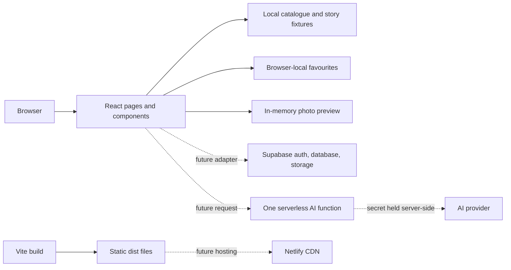
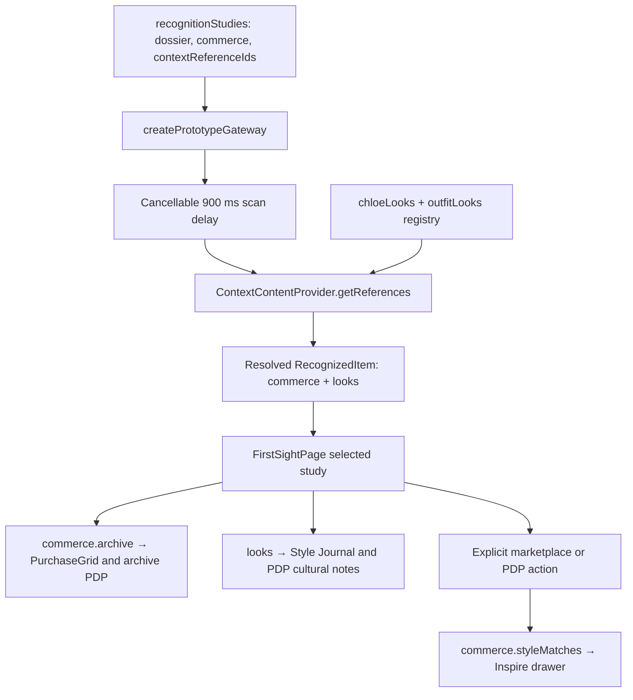

# LoomStory architecture

The implemented application is a static React + TypeScript single-page frontend built with Vite. It demonstrates one product journey without creating backend infrastructure.

For specific edits, use the [code guide and change-location map](code-guide.md). It identifies module owners, named flow functions, data sources, styling controls, and state lifetimes. The [FirstSight guide](first-sight-prototype.md) covers the analysis/shopping journey and future gateway integration. The approved [P18 plan](plans/discover-p18-plan.md) moves inspiration to Discover; its [verification record](discover-verification.md) records the completed checks and remaining manual limitations.

Solid connections are implemented. Dashed connections describe the intended later architecture. Neither the Supabase adapter nor the AI function exists as a working service.

## Current boundaries

| Boundary | Responsibility |
| --- | --- |
| Route shell (`App.tsx`) | Navigation, shared browser state, and the small wardrobe/about views |
| `pages/` | Discover, catalogue, item details, stories, and upload preview screens |
| `components/` | Reusable presentation such as clothing cards |
| `data/` | Shared sample clothing and bag records with stable wardrobe IDs and editorial context |
| `domain/` | Pure saved-item rules that can be tested without rendering React |
| `features/discover/` | Four editorial collections, deterministic six-look ranking, Discover cover and authored-reference hand-off resolver |
| `features/first-sight/` | Continuous-page components, canonical studies, explicit archive/style commerce, authored relationships, injectable gateway and ordered local context provider |
| `scripts/setup-analysis-media.mjs` | Restores available Chloé photographs into Git-ignored `public/local-media/chloe/`; supplied originals stay in ignored `src/images/` |
| `integrations/contracts.ts` | Types for future services; no credentials, SDK initialization, or network traffic |
| Vite | Development server and static production bundle |
| `netlify.toml` | Future build command, output folder, and SPA rewrite |

Search and filters act on local records. Saving an archive item changes browser-local favourites, not inventory. The upload screen reads a user-selected file into a local preview and shows a labelled sample result. Reloading or leaving that screen may discard the draft and photograph. The demo does not submit photos, authenticate users, create database records, or publish listings.

Discover owns inspiration on `/`: `TrendHero` presents a 50/50 cover and an always-visible six-photo board, followed by Vault search, four featured catalogue products and Stories/submission links. Four authored collections update their cover and board together. The `collection` query parameter preserves the selected edit when returning through browser history; an unknown collection displays the first authored edit. This finite board has no regional filter or photo search. Images retain their natural proportions, source links and credits.

FirstSight is one continuous route with two retained sections. Section 1 pairs the persistent `PhotoUploadPanel` with results at 35/65; Section 2 contains the selected study's related products and persistent styling feed. Distinct section surfaces and headers make each part easier to locate. Desktop upload stickiness ends with Section 1. Narrow screens stack the content, and the dossier adapts to its own available width. A Discover link replaces the former inspiration-section anchor.

Cover and photograph-detail actions navigate to `/first-sight?look=<id>`. `resolveInspirationPhoto` resolves only an authored `outfitLooks` ID into the reference variant of `PhotoInput`; it does not accept a query-supplied image URL. App keys the workspace by the requested ID and passes its optional initial photo/unavailable state. Photo state initialises once per mount, so a saved-heart rerender cannot restore a removed or replaced photograph. A changed reference ID remounts the workspace and restores route focus even when the pathname is unchanged. Unknown IDs leave the normal workspace available with a concise notice. Reloading a valid reference URL restores that reference without starting analysis.

Choosing a photograph and pressing **Analyse** are separate actions. `PhotoUploadPanel` validates and decodes a browser-local file, or presents the canonical metadata of a Discover reference. `FirstSightPage` owns its accepted preview, request cancellation, selected study, inline PDP, bag and Inspire visibility. `DiscoveryResult.items` contains five complete `RecognizedItem` studies. Each carries identity, explanation cards, image annotations, resale scenario, cultural narrative, `commerce.archive`, `commerce.styleMatches` and resolved `looks`. `RecognitionResults` selects a study; `FashionDossier` presents it without changing the uploaded photo. Its idle magazine view emphasises the central image and four connected feature labels. Hover, keyboard focus, or tap reveals a compact floating explanation; longer analysis copy remains available through a disclosure.

The styling feed remains mounted beside the selected archive edit regardless of browsing time. There is no automatic collapse or manual hide-inspiration mode. Product selection opens the existing 70/30 detail layout inline below that grid, preserving all earlier sections. A study with no styling references can use the full catalogue width as an empty-data fallback. Journal batch injection pauses while a PDP, bag or Inspire view is open; existing reference cards remain mounted.

## FirstSight data and service flow

`recognition.ts` assembles authored studies from `chloe.ts` and offer fixtures, retaining ordered `contextReferenceIds`. It does not resolve sourced look records. The local `ContextContentProvider` owns that registry and validates duplicate, missing and repeated IDs. `createPrototypeGateway` waits for the cancellable 900 ms scan delay, resolves study references concurrently and preserves authored study order. It returns fresh presentation arrays while canonical records are treated as immutable.

Provider failure rejects the complete analysis and uses the page's existing photo-preserving error/retry flow. Cancellation rejects promptly as `AbortError`, including when an injected provider ignores its signal; late settlement is consumed. Stopping underlying provider work remains that provider's responsibility. A future partial-result policy would need an explicit typed contract rather than silent omission.

Each of the forty-four references carries an authored `relationship`: `same-design`, `runway-reference` or `styling-inspiration`. The current records use forty-two styling and two runway assignments. Contextual cards/dialogs/PDP notes display this relationship; Discover board photographs retain geographic labels without regional filtering. The metadata does not infer exact product identity or authenticate a photographed item. Source, credit, licence and image dimensions remain attached to the record.

Shared catalogue IDs make archive-study products saveable across routes. Chloé facts link to primary references, while scores, prices, stock and resale figures remain prototype assumptions. Four original garment SVGs illustrate generic categories; supplied Chloé photographs stay Git-ignored. The missing TV still remains optional and excluded from the active feed.

## Commerce and state ownership

`commerce.track` is explicit; price never chooses a track. `createCommerceEdit` validates ordered streams and duplicate IDs. The page and `PurchaseGrid` defensively filter archive inputs. Before a bag action, `resolveArchivePurchase` resolves the current archive product and SKU, requires positive integer stock and returns canonical objects. The page clamps quantity against that stock. Incoming callbacks cannot substitute partner offers, prices or invented stock.

The marketplace and archive PDP expose **Explore similar styles** only when the selected study has style matches. The PDP receives a count/action, not an automatic alternative catalogue. One unkeyed `StyleMatchDrawer` stays mounted across both entry points. It owns SKU choices and its native modal lifecycle; the page owns style saves and partner-preview callbacks. A preview revalidates the current style/SKU and emits local feedback without adding to the archive bag or navigating to a partner.

| State | Owner and lifetime |
| --- | --- |
| Archive wardrobe | `App`; browser storage when available and shared across routes |
| Photo/result/selected study | `FirstSightPage`; current analysis, with accepted URL cleanup on replacement/unmount |
| Saved inspiration looks | `App`; shared by Discover and FirstSight for the App visit, reset on full reload; IDs cover all forty Commons and four Chloé references |
| Archive bag and saved styles | Separate `FirstSightPage` states; current mounted visit |
| Discover collection | `TrendHero`; `?collection=<id>` retains the edit through browser history |
| Inspire SKU choices | `StyleMatchDrawer`; current mounted visit, retained across reopening and study switches |
| Archive gallery/SKU | `ProductDetailPanel`; selected product, retained while Inspire opens/closes |
| Checkout-preview completion | `CartPreview`; reset on every bag opening |

Photo, analysis, study and PDP transitions close Inspire. Opening the bag and Inspire are mutually coordinated. Both Inspire triggers focus their actual button before changing state, preserving the return destination in WebKit pointer use. Drawer cleanup restores its opener or calls the host's fallback for a removed/hidden trigger and restores previous overflow-axis declarations. Native `close` events are reconciliation, not new user intent: CartPreview uses explicit Escape/button/backdrop callbacks, so delayed events cannot cancel a new opening.

## Verification architecture

Node contract tests remain separate from browser rendering. P18 adds collection/reference checks while retaining the existing thirty-five contracts. They cover provider/gateway ordering and cancellation, commerce identity/stock rules, recognition integrity and saved-item storage. Repository-owned Playwright specs cover real App-route behaviour and an isolated injected-gateway/modal host. That host uses relative imports and typed controls; no production component exposes test hooks or reads React-private fields.

`playwright.config.ts` owns a dedicated local server and managed Chromium, Firefox and WebKit projects. `playwright.preview.config.ts` checks real-route `@preview` scenarios against the preceding Vite build and excludes the development host. `tsconfig.browser.json` typechecks specs, helpers, host and configs separately from application source. Testing packages are development-only dependencies; there is no runtime framework migration or hosted CI workflow in this slice.

The portable suite substitutes original test artwork only for ignored Chloé URLs; tracked images still load normally and unexpected console/page/HTTP/application-request failures are asserted. This verifies controls/layout independently of private files, not the exact supplied photographs. Exact-photo checks remain separately labelled. Reports/traces/screenshots are ignored; durable commands and measured findings belong in documentation.

The historical P16 gate on 5 November 2026 passed 74 development browser executions across nine projects,
including 55 accessibility state scans, plus three production-preview executions and the existing
35 Node tests. Clean installation and both TypeScript checks passed. The
[verification record](first-sight-verification.md) distinguishes actual results from remaining manual
coverage. P17 delivered that checkpoint as `d32ef3c`; P18 verification is recorded separately in the [Discover record](discover-verification.md). WebKit and touch emulation do not imply actual Safari, physical-device or screen-reader tests.

P18 final verification passed 40 Node tests, both TypeScript checks and 128 development browser
executions of 42 unique scenarios across nine projects. Its 38 accessibility executions produced
85 state scans with zero reported violations; incomplete rule occurrences remain available for
manual judgement. Six checks pass against the current 62-module production build. Deep comparison
preserves all five studies, eighteen offers and forty-four references. P18 remains uncommitted.
See the [Discover verification record](discover-verification.md) for exact counts and limitations.

## Why this fits a three-day prototype

The UI can be developed and demonstrated with no account setup or backend dependencies. Static hosting keeps the deployment small. Separating fixtures, domain rules, and service contracts leaves clear places to connect live data later without turning every screen into an API client.

The trade-offs are deliberate: favourites do not sync between devices, drafts are not durable, there is no access control or real AI inference, and static sample content does not prove a database integration. Browser history routes need the included host rewrite. These limits must remain visible in the demonstration.

## Later integration, not implemented

1. **Supabase data and identity.** Add an adapter behind the contracts for items, stories, saved items, and submissions. Establish ownership rules and row-level security before enabling browser writes. Use Supabase Storage for photographs and Supabase Auth if a real member account is needed.
2. **One AI function.** Choose either a Supabase Edge Function or a Netlify Function. The browser sends an authorised image reference; the function validates the request and calls the AI provider with a server-held secret. Return proposed characteristics and a draft story, with an explicit error/fallback state. Treat the result as a suggestion, not verified provenance.
3. **Netlify hosting.** Connect the selected repository, build with `npm run build`, and publish `dist`. Configure public Supabase settings only after the adapter exists. Keep the AI secret in the selected function platform’s secret store.

There is no need to add Next.js, Docker, a separate custom server, payments, messaging, or recommendation infrastructure to this frontend milestone.
