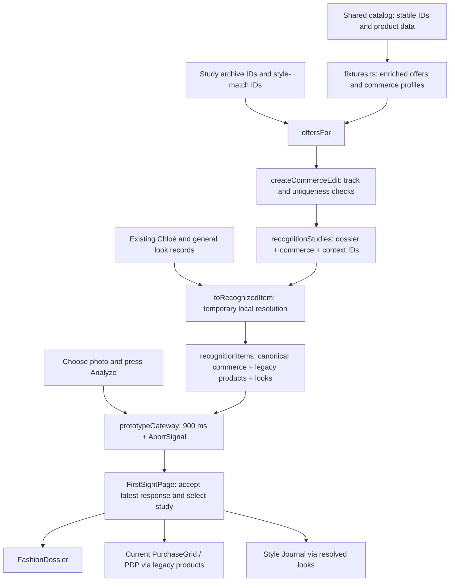

# FirstSight P1–P4 detailed implementation plan

Recorded: 2026-11-04. Status: approved, implemented, and verified on `new-analysis`; the user subsequently authorized a detailed checkpoint commit for this slice. The original plan is retained below, followed by the implementation ledger and FDE assessment.

This slice prepares the data model for the later Vault/Inspire experience. Read it with the [engineering role](first-sight-engineering-role.md) and the saved [P1–P17 roadmap](first-sight-roadmap.md). Those documents retain the deferred work so it can be resumed without reconstructing chat history.

## Product problem and intended outcome

FirstSight currently returns one `products` array per study. Archive examples, designer reissues, and affordable modern concepts share that array. A boolean `affordable` flag controls card badges, while the PDP also uses price to choose alternatives. This gives presentation components an unclear business rule and makes the later archive-only default hard to enforce consistently.

P1–P4 will introduce explicit commerce tracks and separate recommendation lists at the data layer. The existing page will continue receiving a compatibility result until P8–P10 migrate its consumers. The Inspire drawer and visible shopping separation remain later work. This slice does not claim that alternative cards have already been hidden.

The immediate users of this work are the frontend maintainer and future content/catalog adapters. Consumers benefit indirectly through a stable demonstration and a predictable basis for the subsequent UI change.

## Requirements and constraints

| ID | Requirement | Completion evidence |
| --- | --- | --- |
| FR-01 | Every sample offer has an explicit commerce track and listing kind | All eighteen offers are classified |
| FR-02 | Each study owns separate archive and style-match recommendations | Five valid `CommerceEdit` values |
| FR-03 | Price does not determine a product's track | A cheap archive fixture remains archive |
| FR-04 | Legacy views continue receiving valid products and styling references | Existing gateway and five-study journey still work |
| FR-05 | Canonical study data records cultural reference IDs | Every ID resolves to an existing local record |
| FR-06 | Display wording and track rules have one owner | Pure helpers in `commerce.ts` |
| NFR-01 | Preserve stable IDs and existing stock behavior | Catalog/SKU integrity checks |
| NFR-02 | Avoid duplicated editable business metadata | Compatibility fields are derived |
| NFR-03 | Keep the current technology and local execution model | No dependency, API, DB, route, or storage change |
| NFR-04 | Preserve the working UI during the migration | Typecheck, tests, build, and basic browser regression |
| NFR-05 | Make modifications easy to locate | Exact file/symbol log and documented adapter removal |

The attachment's priority categories are separate from phase numbering. This slice is essential foundation work for the requested commerce separation. Cosmetic label tests, new infrastructure, and production recognition remain outside the slice.

## Dependency correction from the full roadmap

The full P1–P17 plan originally removed old fields before their UI replacements were implemented. That works only when all dependent phases ship together. This shorter slice will use an additive migration:

1. Add canonical `commerce` metadata and split lists.
2. Keep the current public gateway result valid through derived legacy fields.
3. Migrate consumers in their assigned later phases.
4. Remove temporary projections after the last consumer changes.

Specifically, keep `products`, `affordable`, `recognitionItems`, and local `looksFor()` temporarily. Define the `ContextRelationship` union in P1, but populate a required `OutfitLook.relationship` in P6. Removing any of these early would require work from deferred phases.

## Exact source and test change boundary

| File | Planned changes in this slice |
| --- | --- |
| `src/features/first-sight/types.ts` | New domain types; required canonical metadata; deprecated compatibility members |
| `src/features/first-sight/commerce.ts` | New pure labels, predicates, and edit validation |
| `src/features/first-sight/fixtures.ts` | Classify eighteen offers; derive legacy flag; retire mixed bag export |
| `src/features/first-sight/recognition.ts` | Split input IDs; canonical studies; local compatibility adapter |
| `tests/firstSightRecognition.test.mjs` | Extend study/commerce/reference integrity checks |
| `tests/firstSightCommerce.test.mjs` | New invariant tests for invalid edits and price-independent tracks |
| `docs/plans/first-sight-roadmap.md` | Update phase status and compatibility checklist after actual work |
| `docs/plans/first-sight-p1-p4-plan.md` | Append actual implementation/check results after actual work |

No React component or CSS selector changes in P1–P4. `FirstSightPage`, `PurchaseGrid`, `ProductDetailPanel`, `PhotoUploadPanel`, `FashionDossier`, `OutfitMasonry`, and `TrendHero` retain their current behavior. The current gateway implementation retains its timing and cancellation code.

## P1 — Model the commerce contract

### A. Requirement and problem

`PurchaseOption.affordable` describes a vague price perception. `RecognizedItem.products` combines two purchasing models. TypeScript cannot currently distinguish an archive offer from a partner-preview offer.

### B. Assumptions

The classification describes the authored sample listing. It does not authenticate a real garment. Designer reissues remain in the archive track with an explicit reissue kind. Generic fictional vintage studies use `archive-study`.

### C. Technical approach

In `types.ts`, add:

```ts
export type CommerceTrack = 'archive' | 'style-match';

export type ArchiveListingKind =
  | 'vintage-original'
  | 'designer-reissue'
  | 'archive-study';

export type ListingKind = ArchiveListingKind | 'partner-preview';

export type CommerceProfile =
  | {
      track: 'archive';
      listingKind: ArchiveListingKind;
      matchReason: string;
    }
  | {
      track: 'style-match';
      listingKind: 'partner-preview';
      matchReason: string;
    };

export interface CommerceEdit {
  archive: PurchaseOption[];
  styleMatches: PurchaseOption[];
}

export type ContextRelationship =
  | 'same-design'
  | 'runway-reference'
  | 'styling-inspiration';

export type RecognitionStudy = Omit<
  RecognizedItem,
  'products' | 'looks'
> & {
  contextReferenceIds: string[];
};
```

Add required `commerce: CommerceProfile` to `PurchaseOption` and `commerce: CommerceEdit` to `RecognizedItem`.

Keep `PurchaseOption.affordable?: boolean` with an `@deprecated` comment identifying its P9/P10 removal. Keep `RecognizedItem.products` with an `@deprecated` comment identifying P8. Add comments that `RecognitionStudy` is authored input and `RecognizedItem` is a resolved UI result.

### D. Trade-offs

The discriminated union is slightly longer than independent `track` and `listingKind` fields, but it prevents invalid combinations during compilation. The temporary old fields keep the current demonstration working; they must be derived and have explicit removal tasks.

### E. Implementation tasks

- P1.1 Add the unions and interfaces above.
- P1.2 Add canonical commerce properties and temporary deprecation comments.
- P1.3 Add `RecognitionStudy` and keep `DiscoveryResult.items: RecognizedItem[]` unchanged.
- P1.4 Leave `OutfitLook` records and required relationship population for P6.

P1–P4 source edits form one coherent migration. Do not leave an intermediate commit with required fields missing from fixtures.

### F. Acceptance criteria and expected result

Given a sample offer, when its commerce profile is authored, then TypeScript permits only valid track/kind combinations. Existing page and gateway prop contracts still compile after the full slice is assembled. Canonical commerce information is required, while existing UI readers remain supported.

### G. Next action

Implement the pure classification and edit-validation functions in P2.

## P2 — Centralize rules and validate edit boundaries

### A. Requirement and problem

Card labels and PDP selection currently encode pieces of the business model in presentation code. Future consumers need a consistent way to classify offers and reject mixed or duplicate edit data.

### B. Assumptions

Authored fixture mistakes should fail clearly during development and tests. The helpers inspect explicit metadata and do not compute recognition confidence, valuation, or a similarity score.

### C. Technical approach

Create `commerce.ts` with imports from `types.ts` only:

| Function | Input → output | Responsibility |
| --- | --- | --- |
| `listingKindLabel(kind)` | `ListingKind → string` | Vintage original / Designer reissue / Archive study / Partner-offer preview |
| `contextRelationshipLabel(relationship)` | `ContextRelationship → string` | Same design / Runway reference / Styling inspiration |
| `isArchiveOffer(product)` | `PurchaseOption → boolean` | Read `product.commerce.track` |
| `isStyleMatchOffer(product)` | `PurchaseOption → boolean` | Read `product.commerce.track` |
| `createCommerceEdit(archive, styleMatches)` | Two ordered offer arrays → `CommerceEdit` | Check membership and uniqueness, then preserve input order |

`createCommerceEdit()` will reject an archive array containing a style-match offer, the reverse case, duplicate IDs within a stream, and IDs repeated across streams. It will report the offending ID. It will not require nonempty lists; that requirement applies to the five current demonstration studies and is checked there. It will not sort by price or mutate the input arrays.

### D. Trade-offs

A small pure module gives future UI components reusable rules without importing fixture registries. Runtime edit checks complement TypeScript because TypeScript cannot prove that every element in a general array belongs to the correct stream.

### E. Implementation tasks

- P2.1 Add exhaustive label mappings for the two unions.
- P2.2 Add explicit track predicates.
- P2.3 Add `createCommerceEdit()` with descriptive invariant failures.
- P2.4 Add function comments covering intent, input ordering, and rejection behavior.

### F. Acceptance criteria and expected result

Given a €58 archive example, when `isArchiveOffer()` runs, then it returns true. Given a €95 partner preview, it remains style-match. Changing a price does not change either classification. Invalid stream membership and duplicate IDs are rejected; a valid edit preserves the curated order and input arrays.

### G. Next action

Populate the actual fixture profiles in P3.

## P3 — Classify the eighteen sample offers

### A. Requirement and problem

`offerDetails` currently has five manually authored `affordable` flags and thirteen implicit defaults. There is no precise listing-kind metadata or explanation of why an offer belongs in an edit.

### B. Assumptions

Use the existing catalog IDs and commercial sample data. The two Paddington original listings remain imagined vintage examples; the supplied photograph remains a reissue reference. Do not relabel generic studies as authenticated originals.

### C. Technical approach

Modify `OfferDetails` in `fixtures.ts` to require `commerce: CommerceProfile`. Remove its editable `affordable` input. Populate all entries as follows:

| Offer ID | Track | Listing kind |
| --- | --- | --- |
| `chloe-paddington-archive` | archive | vintage-original |
| `chloe-paddington-complete` | archive | vintage-original |
| `chloe-paddington-reissue` | archive | designer-reissue |
| `soft-satchel-alternative` | style-match | partner-preview |
| `bomber-archive` | archive | archive-study |
| `bomber-alternative` | style-match | partner-preview |
| `minimalist-leather` | archive | archive-study |
| `weekend-layer` | archive | archive-study |
| `denim-jacket-archive` | archive | archive-study |
| `denim-jacket-alternative` | style-match | partner-preview |
| `archive-denim` | archive | archive-study |
| `record-shop-denim` | archive | archive-study |
| `blazer-archive` | archive | archive-study |
| `blazer-alternative` | style-match | partner-preview |
| `city-coat` | archive | archive-study |
| `gallery-coat` | archive | archive-study |
| `workwear-archive` | archive | archive-study |
| `workwear-alternative` | style-match | partner-preview |

Author a concise `matchReason` for each offer, such as “Soft volume and curved handles echo the Paddington silhouette” for the satchel. Describe visible design relationships. Do not imply live AI comparison or a real partner agreement.

In `sampleOffers`, copy `details.commerce` into each `PurchaseOption` and derive:

```ts
affordable: details.commerce.track === 'style-match'
```

This line is a temporary adapter for the current grid and PDP. It is never an independent source of classification. Preserve `offersFor(ids)` and its missing-ID failure. Retire `purchaseOptions` only once P4 replaces the bag study's mixed-list import.

### D. Trade-offs

Explicit profiles add authored data but make intent reviewable. Keeping the existing global catalog unchanged avoids expanding the slice into `/vault`, wardrobe, or legacy item pages.

### E. Implementation tasks

- P3.1 Change `OfferDetails` and its imports.
- P3.2 Add eighteen profiles and match reasons.
- P3.3 Update `sampleOffers` enrichment and the derived legacy flag.
- P3.4 Preserve product IDs, prices, source/image metadata, variants, stock, and gallery labels.
- P3.5 Remove the obsolete mixed bag export during the P4 consumer switch.

### F. Acceptance criteria and expected result

Every resolved offer has a nonempty match reason and a valid profile. There are thirteen archive offers and five style-match offers. Existing IDs still resolve in the shared catalog; sizes and stock are unchanged. Existing badge/sorting readers receive the same boolean classification through the derived field.

### G. Next action

Assign the classified offers to each study's explicit streams in P4.

## P4 — Assemble separate study edits and preserve the current gateway

### A. Requirement and problem

Each `GarmentStudyInput.productIds` currently mixes product tracks. Renaming `recognitionItems` or removing `looksFor()` immediately would break the current gateway and test imports before P5 is available.

### B. Assumptions

Retain the current study order, IDs, dossier text, confidence values, annotation coordinates, resale data, and cultural references. The public gateway still returns five fully resolved studies after its existing delay.

### C. Technical approach

Modify `recognition.ts`:

1. Replace `productIds` with `archiveProductIds` and `styleMatchProductIds` in `GarmentStudyInput`.
2. Rename `lookIds` to `contextReferenceIds` without changing the actual reference IDs.
3. Change `garmentStudy()` to return `RecognitionStudy` and construct `commerce` through `createCommerceEdit(offersFor(...), offersFor(...))`.
4. Change `paddingtonStudy` to the same authored-input shape, listing the Chloé reference IDs from `chloeLooks`.
5. Export `recognitionStudies: RecognitionStudy[]` in the original order.
6. Extend local `looksFor(ids)` to resolve both `chloeLooks` and `outfitLooks`, retaining order and missing-ID errors.
7. Add a private `toRecognizedItem(study): RecognizedItem` function. Remove `contextReferenceIds` from its output, resolve `looks`, and derive legacy `products` from the two canonical commerce streams.
8. Keep `export const recognitionItems = recognitionStudies.map(toRecognizedItem)` so `services/prototype.ts` and existing tests continue working.

Exact stream assignments:

| Study ID | Archive IDs | Style-match IDs |
| --- | --- | --- |
| `chloe-paddington` | `chloe-paddington-archive`, `chloe-paddington-complete`, `chloe-paddington-reissue` | `soft-satchel-alternative` |
| `leather-bomber` | `bomber-archive`, `minimalist-leather`, `weekend-layer` | `bomber-alternative` |
| `denim-jacket` | `denim-jacket-archive`, `archive-denim`, `record-shop-denim` | `denim-jacket-alternative` |
| `tailored-blazer` | `blazer-archive`, `city-coat`, `gallery-coat` | `blazer-alternative` |
| `workwear-jacket` | `workwear-archive`, `denim-jacket-archive` | `workwear-alternative`, `denim-jacket-alternative` |

The derived legacy order is archive offers followed by style-match offers. All current offers remain available to the existing UI; some cards therefore change position. No filtering, drawer, cart exclusion, or visible relationship labeling is claimed in this slice.

### D. Trade-offs

The local adapter is a small temporary bridge. It avoids implementing the deferred content provider or changing React components just to keep the build green. P5 will replace it with gateway composition; P8 will remove the flattened product field after the page switches to explicit streams.

### E. Implementation tasks

- P4.1 Update input types and `garmentStudy()`.
- P4.2 Convert the bag study and remove the mixed fixture import/export.
- P4.3 Add canonical `recognitionStudies` and the local reference resolver bridge.
- P4.4 Add `toRecognizedItem()` and retain the current `recognitionItems` export.
- P4.5 Document compatibility ownership/removal in source comments.
- P4.6 Extend data-contract tests and run the slice's quality checks.

### F. Acceptance criteria and expected result

Given any of the five canonical studies, when its commerce edit is built, then both streams contain only their declared track and no duplicate IDs. Given the current gateway, when analysis completes, then it still returns five `RecognizedItem` values with dossiers, products, looks, and the new canonical commerce data. Selecting a study continues updating the current dossier and product collection. Aborting an old scan still cannot replace a newer result.

### G. Next action

Deliver the verified P1–P4 source/data change and update this ledger. Leave P5–P17 deferred until separately scheduled by the user.

## End-to-end principle and process

The principle is to keep one authored source for each fact, resolve stable IDs at a boundary, and pass complete data to the presentation. Product classification belongs to offer metadata. Recommendation membership belongs to a study. The selected study belongs to the page state. Components render the supplied data.

After P1–P4, the process is:

1. `src/data/catalog.ts` supplies unchanged sample product identities, images, and prices.
2. `fixtures.ts` enriches them with conditions, SKU stock, and explicit commerce profiles.
3. `offersFor(ids)` resolves a study's authored product IDs.
4. `createCommerceEdit()` validates separate archive and style-match streams.
5. `recognitionStudies` holds dossier content, the validated commerce edit, and context reference IDs.
6. `toRecognizedItem()` resolves local references and derives the legacy flattened product array once.
7. `prototypeGateway.discover(photo, signal)` returns those five resolved studies after 900 ms.
8. `FirstSightPage.analyze()` accepts only the latest uncancelled response.
9. `selectRecognition(id)` selects one study; the dossier, current product grid, and journal read that study together.
10. Later, P8–P10 will read the already separated streams to implement the visible archive/default and Inspire/opt-in behavior.



Selecting or uploading a photograph does not classify its pixels. The gateway returns the same authored studies, as already approved for the prototype. A future recognition adapter can return the same contract without moving business rules into components.

## Verification workflow for this slice

1. Record the starting branch/commit and existing working-tree changes; preserve unrelated edits.
2. Run the existing typecheck and tests before implementation and record any baseline failures.
3. Apply the interdependent P1–P4 model, helper, fixture, and assembly changes as one coherent source slice.
4. Extend `firstSightRecognition.test.mjs` to check all five canonical and resolved studies, stream membership, exact counts, catalog IDs, stock, unique IDs, resolved references, and legacy projections. Keep current annotation, asset, and cancellation checks.
5. Add `firstSightCommerce.test.mjs` cases for invalid track membership, duplicate/overlapping IDs, valid ordered edits, unchanged inputs, and classification independent of price. Avoid tests that merely copy label strings.
6. Run `npm run typecheck`, `npm test`, `npm run build`, and `git diff --check`.
7. Use the existing development server, or start an isolated one if needed. Verify the sample → Analyze → five choices → dossier → products/journal path and switching all five studies. Confirm the PDP, sample bag, and saved-item behavior still work.
8. Inspect source changes, file list, and comments. Record actual results and any limitation in the activity ledger below.

No visual redesign is planned, so the full five-viewport visual audit remains P15. A focused narrow-screen regression check is appropriate if the changed product order exposes an issue.

## Decision log

| Decision | Reason | Alternative and limitation | Revisit |
| --- | --- | --- | --- |
| Explicit tracks independent of price | Supports both low-cost vintage and modern style matches | Price thresholds misclassify products | When real listing schemas arrive |
| Discriminated `CommerceProfile` | Makes invalid track/kind combinations a compile error | Independent fields require more runtime checks | When additional commerce models exist |
| Required canonical commerce data plus derived legacy fields | Keeps this shorter slice runnable | Immediate removal forces P5/P8/P9/P10 into scope | Remove adapters in their mapped phases |
| Keep reference resolution local through P4 | Preserves current looks without building P5 | API/provider boundary remains deferred | P5 |
| Define relationship vocabulary now, populate records in P6 | Keeps phase ownership clear and source changes small | Labels are unavailable to UI until P6/P11 | P6 |
| Retain the current UI during the data slice | Protects the demonstration and isolates architectural changes | Default marketplace remains mixed until P8/P9 | P8–P10 |

## Activity ledger

| Activity | Status | Evidence |
| --- | --- | --- |
| Read the complete attached FDE role | Done in planning turn | 640-line attachment read through EOF |
| Inspect current consumers and fixture counts | Done in planning turn | `products`, `affordable`, `recognitionItems`, and `looksFor` dependencies identified |
| Save role, full roadmap, and expanded slice plan | Done in planning turn | Three files in `docs/plans/` |
| User approval of revised P1–P4 slice | Received 2026-11-04 | User explicitly authorized implementation and requested an FDE assessment |
| P1.1–P1.4 source implementation | Complete | Explicit contracts in `types.ts`; compatibility fields documented; relationship population deferred |
| P2.1–P2.4 source implementation | Complete | Five pure helpers in `commerce.ts`; ordered copied arrays and membership/ID validation |
| P3.1–P3.5 source implementation | Complete | Eighteen offer profiles and reasons; derived legacy flag; mixed bag export retired |
| P4.1–P4.5 source implementation | Complete | Five canonical studies; explicit stream IDs; ordered local resolution; derived gateway-compatible output |
| P4.6 source checks and browser regression | Passed | Typecheck, 18 tests, build, diff check, data preservation, Chrome desktop/mobile checks |
| Independent engineering review | Completed | No blocking source defect identified within the approved slice |
| P1–P4 checkpoint commit | Authorized after assessment | User requested a detailed Git commit using EU System v1.15.0 conventions; record the source, tests, plans, and this report together |
| P17 final feature commit | Deferred | The separately authorized P1–P4 checkpoint records only this slice; pushing and merging remain deferred |

## Implementation and FDE assessment — 2026-11-04

### A. Requirement and outcome

P1–P4 are complete. FirstSight now has an explicit archive/style-match data model, eighteen classified offers, five validated study edits, and a compatibility adapter that keeps the current demonstration working. This prepares the later Vault/Inspire UI separation while preserving the approved scope.

### B. Assumptions and decisions applied

Recognition remains a deterministic local demonstration. Tracks describe authored listing intent; they are independent of price and do not authenticate inventory. The designer reissue belongs to the archive track with its distinct listing kind. Existing commercial and dossier data were preserved.

The additive migration was implemented as approved: `affordable` is derived from `commerce.track`, and `products` is derived from the two study streams. `recognitionItems` remains available to the existing gateway. Product order is archive first, followed by style matches. The existing UI still displays both tracks and retains its current bag/wardrobe behavior until P8–P10.

### C. Technical approach delivered

| File | Exact owners changed or added |
| --- | --- |
| [types.ts](../../src/features/first-sight/types.ts) | `CommerceTrack`, `ArchiveListingKind`, `ListingKind`, discriminated `CommerceProfile`, `CommerceEdit`, `ContextRelationship`, `RecognitionStudy`; required commerce fields and deprecated compatibility members |
| [commerce.ts](../../src/features/first-sight/commerce.ts) | `listingKindLabel`, `contextRelationshipLabel`, `isArchiveOffer`, `isStyleMatchOffer`, `createCommerceEdit` |
| [fixtures.ts](../../src/features/first-sight/fixtures.ts) | `OfferDetails`, eighteen `offerDetails` records, `sampleOffers`; removed `purchaseOptions`; preserved `offersFor` behavior |
| [recognition.ts](../../src/features/first-sight/recognition.ts) | `GarmentStudyInput`, `garmentStudy`, `paddingtonStudy`, four garment input records, `looksFor`, new `recognitionStudies`, new `toRecognizedItem`, derived `recognitionItems` |
| [firstSightCommerce.test.mjs](../../tests/firstSightCommerce.test.mjs) | Six new rule/lookup tests |
| [firstSightRecognition.test.mjs](../../tests/firstSightRecognition.test.mjs) | Three new commerce/compatibility integrity tests and gateway-result parity assertion |

No React component, CSS class, route, dependency, gateway timing/cancellation implementation, source photograph, or shared catalog record was changed. Planning status and this report were updated in the three `docs/plans/` documents.

### D. Trade-offs and engineering assessment

- **Data correctness:** explicit profiles replace implicit classification. `createCommerceEdit` rejects incorrect stream membership and duplicate identities while preserving order. Empty streams remain valid for future adapters.
- **Maintainability:** listing intent belongs to fixtures, recommendation membership to studies, and shared rules to a small pure module. Comments identify responsibilities and the phases that remove temporary fields.
- **Integration stability:** the temporary adapter keeps existing components and the gateway valid. Baseline comparison confirms preservation of all previous study and offer properties apart from the approved product order.
- **Appropriate scope:** the implementation uses the existing stack and adds no runtime dependencies. The two-stream arrays are ordinary typed arrays; construction-time validation enforces their membership.
- **Remaining technical debt:** the resolved export and legacy fields are projections created when the modules load. Treat fixtures as immutable; they are not synchronized mutable stores. P5 and P8–P10 own their removal.
- **Future integration constraint:** TypeScript protects authored code, not untrusted network responses. Runtime provider-schema validation belongs at a future real integration boundary. No external provider is connected in this slice.
- **Product limitation:** the visible archive-only marketplace and opt-in drawer remain deferred. These data changes alone do not enforce checkout or wardrobe separation, nor change the global `/vault` route.

The assessment is that the slice meets its acceptance criteria and is ready for the next planned integration step. Independent code review found no blocking defect within this scope. This is an assessment of the prototype's data migration, not production readiness or completed Vault/Inspire UX.

### E. Implementation record

The source change covers four modules, including the new `commerce.ts`, plus two test files. Classification totals are thirteen archive offers and five partner previews: two vintage-original examples, one designer reissue, ten archive studies, and five modern alternatives. Four studies have a 3/1 split; workwear has a 2/2 split.

The only cleanup found by the diff gate was an extra blank line at the end of `fixtures.ts`; it was removed. A browser test initially needed a wait for the wardrobe DOM after route navigation; correcting the test timing resolved it without an application change.

### F. Verification actually performed

| Check | Result and scope |
| --- | --- |
| Baseline `npm run typecheck` and `npm test` | Passed before implementation; nine original tests |
| Final typecheck | Passed |
| `npm test` | Eighteen tests passed; nine added, nine original retained |
| `npm run build` | Passed; Vite production bundle generated |
| `git diff --check` | Passed after whitespace cleanup |
| Comparison with starting HEAD | All five study records retain dossier/identity/annotation/resale/culture/look data and order; all eighteen offers retain price, stock/SKUs, condition, gallery, media, and legacy flags |
| Independent code review | No blocking source defect; separate preservation audit agreed with the comparison |
| Chrome desktop, 1440 × 900 | Sample selection, explicit Analyze, cancellation, five study switches, synchronized dossier/grid/journal, four cards per edit, archive-first order, four looks per study |
| PDP and bag regression | Size required before buying; sold-out reissue disabled; Chloé stock-one limit and €700 preview; bomber unavailable S, available M, stock-two limit, quantity changes, cart retained across study switches |
| Journal and wardrobe regression | Source/credit dialog and Escape; archive and alternative product saves still resolve in wardrobe and persist through reload |
| Chrome mobile emulation, 320 × 844 | Annotation popover, PDP and bag usable; static upload panel; no horizontal overflow |
| Browser diagnostics | Zero observed page/console errors, HTTP failures, or API/mutation requests during the exercised flows |

Temporary browser script: `/tmp/loomstory-first-sight-qa/p1-p4-regression.mjs`. Inspected mobile screenshot: `/tmp/loomstory-first-sight-qa/p1-p4-mobile.png`. These temporary artifacts are outside the repository and may be cleaned by the system. They are supporting evidence, not installed project test dependencies.

Browser coverage is Chrome desktop and touch emulation. Safari, Firefox, physical devices, real uploads in this slice, and a full accessibility audit were not exercised. Existing file-handling code was unchanged. Node printed its existing experimental type-stripping/mock-timer notices; the checks passed.

### G. Next action

The next roadmap step is P5: introduce the local context-content provider and let the gateway compose `recognitionStudies` with its resolved references. Use the current compatibility contracts while migrating that boundary, then remove its temporary resolver/export. P6 can populate cultural relationship metadata before the later drawer and page integration work.

P5–P17 remain deferred. Following this assessment, the user authorized a detailed P1–P4 checkpoint commit on `new-analysis`. The checkpoint records the completed slice and this report using the [EU System v1.15.0 Git conventions](https://ec.europa.eu/component-library/v1.15.0/eu/docs/conventions/git/). It does not include a push or merge, or implement the deferred phases. The separate final feature commit remains P17.
