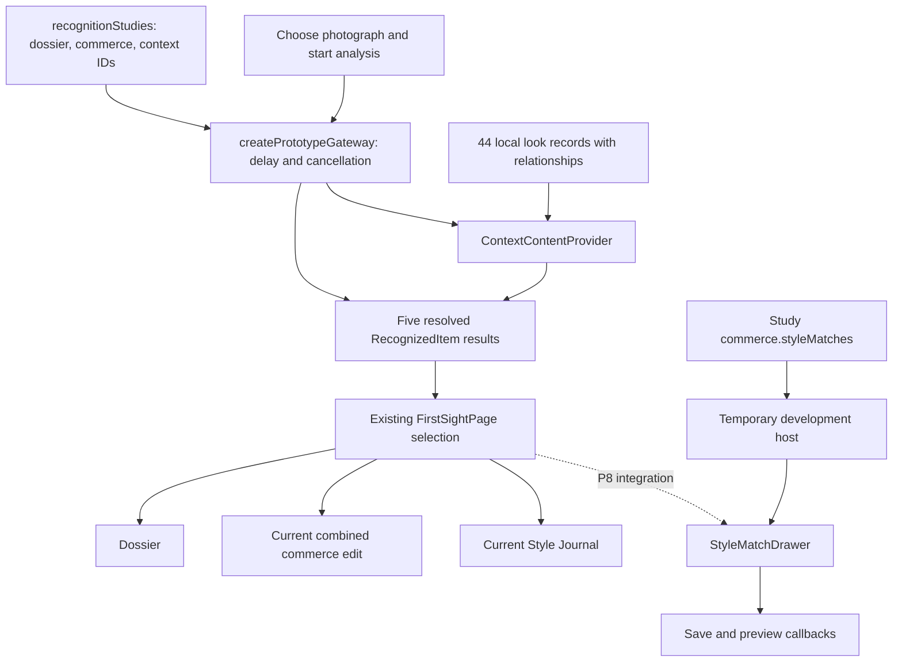

# FirstSight P5–P7 detailed implementation plan

Delivery update, 5 November 2026: the user authorised the combined P5–P12 commit, push and merge to
`new-home-page`. The review-only restrictions below record the earlier implementation period and
are superseded for this checkpoint. See the roadmap for the current delivery boundary.

Recorded: 4 November 2026. Status: self-assessed, strengthened and implemented under the user's conditional approval. The original plan is retained below, followed by the implementation assessment. No commit is authorised.

Starting point: `df562e293f445f0d7cc19e73f5e622ac36b623dd` on `new-analysis`, pushed to `origin/new-analysis`. P1–P4 are implemented and verified. Use this document with the [full roadmap](first-sight-roadmap.md), [P1–P4 assessment](first-sight-p1-p4-plan.md#implementation-and-fde-assessment--2026-11-04), and [engineering working agreement](first-sight-engineering-role.md).

Use British English for new prose, comments, documentation, interface copy, and commit messages. Preserve existing public identifiers such as `RecognizedItem`, `analyze`, and `color`; renaming them is a separate change.

## Product problem and intended outcome

P1–P4 give every study separate archive and style-match recommendations. Three remaining gaps belong to this slice:

1. Context resolution still happens synchronously inside `recognition.ts`, rather than through an injectable service boundary.
2. Cultural references carry sources and credits but no explicit relationship to the item study.
3. The Inspire drawer has no reusable implementation for the later page integration.

P5 will move reference resolution behind a local provider. P6 will add authored relationship metadata. P7 will build and independently verify the drawer. Together these deliver a testable service boundary, enriched local records, and a component ready to connect in P8.

## Scope boundary and dependency correction

The existing FirstSight page will use the P5 gateway composition automatically because it already imports `prototypeGateway`. Its visible recognition, dossier, and combined product flow will continue to work.

The drawer's production entry points belong to P8, and removing automatic alternatives from the PDP belongs to P10. P7 will therefore build and test the drawer through an isolated development harness. It will not add a dead button or a demonstration route to the consumer application. The harness will control the same props that P8 will later supply.

After P7, the drawer will be ready for integration but will not yet appear on the production FirstSight route. If a visible opt-in drawer is required as this slice's acceptance condition, the necessary P8–P10 changes should be approved as an explicit extension. The default scope here remains P5–P7.

The runtime will continue using local fixtures. Future Instagram, YouTube, Commons, and curator integrations will be documented as adapter connection points. No provider account, SDK, external request, credential, embed script, database, affiliate destination, or checkout will be introduced.

## Requirements and completion evidence

| ID | Requirement | Completion evidence |
| --- | --- | --- |
| FR-05-01 | Resolve each study's context IDs through an injectable provider | Gateway factory accepts a fake or local provider |
| FR-05-02 | Preserve context order, source metadata, and empty results | Provider contract and ordered-resolution tests |
| FR-05-03 | Reject missing or ambiguous reference IDs | Named validation errors containing the offending ID |
| FR-05-04 | Honour cancellation throughout delay and provider resolution | Abort tests before, during, and after the simulated delay |
| FR-05-05 | Preserve the current resolved UI contract | Five complete results with legacy products and resolved looks |
| FR-06-01 | Assign an explicit authored relationship to every active look | All 44 local reference records have a valid value |
| FR-06-02 | Distinguish source context from product identity | Conservative classification and documented meanings |
| FR-07-01 | Render only style-match offers in the Inspire drawer | Archive offers cannot render as partner-preview cards |
| FR-07-02 | Support size selection, saving, and partner preview | Browser harness records actual callbacks and feedback |
| FR-07-03 | Preserve selected sizes across close/reopen | Per-product SKU state survives while the drawer stays mounted |
| FR-07-04 | Close accessibly and restore focus | Keyboard, close button, backdrop, and parent-controlled checks |
| NFR-01 | Keep responsibilities narrow and comments useful | Provider, gateway, fixture, and component ownership recorded |
| NFR-02 | Preserve the continuous FirstSight demonstration | Current page browser regression passes |
| NFR-03 | Make the drawer responsive and keyboard/touch usable | Desktop, tablet, and narrow mobile harness checks |
| NFR-04 | Avoid new runtime dependencies | Existing React, TypeScript, Vite, native dialog, and test tools |
| NFR-05 | Keep scope and verification claims traceable | Task ledger, exact file/symbol report, and actual check results |

## Exact file and symbol change map

All feature-relative paths below start at `src/features/first-sight/`.

| File | Action | Exact responsibility |
| --- | --- | --- |
| `services/content/contracts.ts` | Create | `ContextContentRequest`, `ContextContentProvider` |
| `services/content/prototype.ts` | Create | `createPrototypeContextContentProvider`, `prototypeContextContentProvider`, local registry lookup |
| `services/content/providers/README.md` | Create | Future adapter contract, metadata, credentials, cancellation, failures, and embedding boundaries |
| `services/prototype.ts` | Modify | `createPrototypeGateway`, existing `prototypeGateway`, cancellable delay and provider composition |
| `services/contracts.ts` | Modify comments | Explain orchestration behind the existing `FirstSightGateway` contract |
| `recognition.ts` | Modify | Retain `recognitionStudies`; remove `looksFor`, `toRecognizedItem`, and `recognitionItems` after migration |
| `types.ts` | Modify | Require `OutfitLook.relationship`; keep current commerce contracts and legacy UI members |
| `chloe.ts` | Modify reference records only | Add relationships to four `chloeLooks` entries |
| `looks.ts` | Modify reference records only | Add relationships to forty `outfitLooks` entries |
| `components/StyleMatchDrawer.tsx` | Create | `StyleMatchDrawerProps`, `StyleMatchDrawer`, internal `StyleMatchCard`, dialog and SKU behaviour |
| `components/style-match-drawer.css` | Create | Drawer, card, responsive, focus, backdrop, and reduced-motion styles |
| `tests/firstSightRecognition.test.mjs` | Modify | Test canonical studies and results obtained through the gateway instead of the retired export |
| `tests/firstSightContentProvider.test.mjs` | Create | Registry integrity, ordered resolution, failure, and cancellation coverage |
| `tests/firstSightCommerce.test.mjs` | Retain | Existing business rules remain valid; change only if a demonstrated dependency requires it |
| `docs/plans/first-sight-p5-p7-plan.md` | Update after implementation | Activity ledger, actual results, and A–G FDE assessment |
| `docs/plans/first-sight-roadmap.md` | Update after implementation | Phase statuses and compatibility-removal checklist |

No change is planned to `FirstSightPage.tsx`, `PurchaseGrid.tsx`, `ProductDetailPanel.tsx`, `OutfitMasonry.tsx`, their current styles, application routes, or shared wardrobe storage. P8–P12 own those integrations. Documentation will distinguish component readiness from production integration.

## P5 — Introduce the local context-content provider

### A. Requirement and problem

`recognition.ts` currently owns both the authored studies and the lookup of concrete look objects. The gateway simply returns the pre-resolved `recognitionItems` array after 900 ms. That makes it difficult to replace context discovery independently, exercise slow providers, or verify cancellation after the initial scan delay.

### B. Clarifications and assumptions

The local provider will resolve only the IDs supplied by a study. It will preserve their order and original metadata. Empty ID lists are valid. Invalid fixture IDs will fail clearly rather than silently disappear or receive fabricated replacements.

The 900 ms demonstration delay remains. A provider can add asynchronous resolution time, so completion means both the delay and context composition have finished. The page's existing request-identity and abort guards remain a second layer of protection.

### C. Technical approach

Create `services/content/contracts.ts`:

```ts
export interface ContextContentRequest {
  itemId: string;
  referenceIds: readonly string[];
}

export interface ContextContentProvider {
  readonly id: string;
  getReferences(
    request: ContextContentRequest,
    signal: AbortSignal,
  ): Promise<OutfitLook[]>;
}
```

Create `createPrototypeContextContentProvider(references: readonly OutfitLook[])`. Build a registry once per provider instance from the supplied records. Reject duplicate registry IDs at construction. Its `getReferences()` implementation will reject an already-aborted signal, resolve each requested ID in order, reject missing or repeated request IDs with the ID in the error, and check cancellation before returning. Keep original record metadata and return a new result array.

Export `prototypeContextContentProvider` using the existing four Chloé references and forty general references. Do not fetch media or infer new relationships inside the provider.

Add `createPrototypeGateway(contentProvider = prototypeContextContentProvider): FirstSightGateway`. Export the existing `prototypeGateway` name as the default factory result so `FirstSightPage` needs no import change.

The gateway will:

1. Reject an already-aborted request.
2. Await the cancellable 900 ms delay.
3. Request references for each canonical study using the same `AbortSignal`.
4. Resolve studies concurrently while preserving their original order.
5. Assemble each `RecognizedItem` with canonical `commerce`, resolved `looks`, and the temporary flattened `products` array.
6. Remove `contextReferenceIds` from the resolved UI result.
7. Check cancellation before returning the final `DiscoveryResult`.

Use small private cancellation helpers in `services/prototype.ts`, such as `waitForPrototypeDelay(signal)` and `withAbort(promise, signal)`, if needed. `withAbort` must reject promptly during an injected provider's pending work even if that provider ignores the signal. Remove abort listeners on completion or cancellation and consume late provider settlement to avoid an unhandled rejection. Cancellation of underlying provider work still depends on that provider honouring the signal.

After migrating imports and tests, delete the temporary `recognitionItems` export, `toRecognizedItem()`, and `looksFor()` from `recognition.ts`. That module will export authored studies and reference IDs only. Keep `RecognizedItem.products` and `PurchaseOption.affordable` for P8–P10.

### D. Trade-offs and failure policy

A provider factory adds one explicit seam while keeping local fixtures as the default. It permits deterministic tests without a service account or an additional library.

For this slice, a context-provider failure rejects the analysis request and uses the existing page error/retry behaviour. Do not silently present a successful result with missing context. A later live integration can introduce a typed partial-result policy if the product requires one.

The future-adapter README will describe normalising metadata, source/credit fields, image dimensions, server-held credentials, caching, rate-limit handling, timeouts, partial-result decisions, and provider-specific embedding. It will state that a future image/embed discriminated union belongs with the actual renderer integration; no arbitrary embed HTML will enter current components.

### E. Implementation tasks

- P5.1 Add the provider request/interface contract.
- P5.2 Add the local registry factory and default provider.
- P5.3 Add the injectable gateway factory and cancellation-safe composition.
- P5.4 Migrate gateway/test consumers and remove the P4 resolver/export bridge.
- P5.5 Document Instagram, YouTube, Commons, and curator adapter connection points.
- P5.6 Add relevant tests and verify the existing five-study route.

### F. Acceptance criteria and expected result

Given an injected provider that returns references in the requested order, when analysis finishes, then the gateway returns all five studies in their existing order with unchanged dossiers and commerce edits. Every current study still has four resolved references.

Given an aborted request during either the delay or provider work, when the signal is aborted, then the gateway rejects with `AbortError`; a late provider result cannot become a valid response. Given a missing ID or a failed provider, the existing analysis error/retry flow remains usable.

Expected result: future content sources can be connected behind one interface while the existing page continues receiving its current complete result contract.

### G. Next action

Populate the relationship metadata required by P6, then rerun provider/gateway checks against those enriched records.

## P6 — Add authored cultural relationship metadata

### A. Requirement and problem

`OutfitLook.kind` describes the type of photograph, such as celebrity style or editorial. It does not explain how that photograph relates to a recognised item. Source attribution alone does not establish that every photographed bag is the same model or edition.

### B. Clarifications and recommended classification

Use the existing `ContextRelationship` vocabulary. Define `same-design` as a manually established link to the same design family, not the same physical object or production edition. Use `runway-reference` for a runway context whose exact product identity may remain uncertain, and `styling-inspiration` for a visual or styling connection.

Recommended initial mapping:

| Records | Relationship | Reason |
| --- | --- | --- |
| All forty general celebrity/editorial references | `styling-inspiration` | Their current descriptions provide styling context rather than product identification |
| `paddington-styling-01` | `styling-inspiration` | Supplied street-style reference without a verified model/edition record |
| `paddington-styling-02` | `styling-inspiration` | Existing local caption describes a padlock bag and styling context |
| `paddington-styling-03` | `runway-reference` | Existing record explicitly describes runway context |
| `paddington-styling-04` | `runway-reference` | Existing record describes a runway look and an unverified exact bag model |

Keep `same-design` supported without assigning it by guesswork. This recommendation is part of the plan for approval; it does not require new image research or API calls.

### C. Technical approach

Add required `relationship: ContextRelationship` to `OutfitLook` in `types.ts`. Add the value explicitly beside `kind` in every active `chloeLooks` and `outfitLooks` record. Preserve IDs, titles, images, source links, author/licence fields, original dimensions, and existing descriptions.

The provider and gateway carry the field through unchanged. `contextRelationshipLabel()` from P2 already owns the display vocabulary. P11 will use it in the Style Journal; adding data in P6 does not change the current badge or dialog copy.

This simple field is adequate while each supplied reference has one authored classification. If one photo later has different product relationships across studies, move that relationship onto the study/reference association at the future integration boundary.

### D. Trade-offs

A required field makes incomplete new fixture records a type error and keeps classification reviewable. Conservative values preserve the current evidence rather than adding stronger product-identity claims for the demonstration.

### E. Implementation tasks

- P6.1 Add the required field and explain its meaning in the type comment.
- P6.2 Populate the forty general records and four Chloé records.
- P6.3 Extend integrity checks for allowed values, coverage, and provider preservation.
- P6.4 Verify unchanged source metadata and dossier/media content against the P1–P4 checkpoint.

### F. Acceptance criteria and expected result

Given any active look, when it is authored or returned by the provider, then it has one valid relationship. All 44 records are covered, and all five gateway results preserve the selected references' relationships and attribution.

Expected result: P11 can display honest relationship labels using already-structured data. No additional classification logic is needed in React components.

### G. Next action

Build the P7 component against the existing `styleMatches` product arrays, independently of the cultural-reference renderer.

## P7 — Build the reusable Inspire drawer

### A. Requirement and problem

P1–P4 prepare affordable style-match data, but there is no dedicated interface component for exploring it. P7 must deliver the component and prove its interactions before P8 connects it to FirstSight.

### B. Clarifications and assumptions

Use a native modal dialog. The component is controlled by a host through `open` and callbacks. The host owns saved IDs and preview handling; the drawer owns selected SKUs and temporary status text. State lasts for the mounted visit.

Partner offers remain fictional previews. A preview action records the selected product and size and displays local feedback; it does not create an order or add an alternative to the archive bag. Require size selection even for a one-size product, consistent with the existing PDP.

### C. Technical approach

Create `components/StyleMatchDrawer.tsx`:

```ts
export interface StyleMatchDrawerProps {
  open: boolean;
  itemName: string;
  products: PurchaseOption[];
  savedIds: string[];
  onClose: () => void;
  onToggleSave: (id: string) => void;
  onPreviewPartner: (
    product: PurchaseOption,
    variant: PurchaseVariant,
  ) => void;
}
```

Use a local `selectedSkusByProductId` record so choosing a size survives closing and reopening. Resolve each stored SKU against the latest product variants before enabling preview; an unavailable or removed SKU becomes inactive. Preserve other products' selections when the current edit changes. Do not mutate incoming products or saved IDs.

Render only `isStyleMatchOffer(product)` records, preserving their supplied order. Show an informative empty state when there are none. This is a defensive rendering boundary; classification remains owned by the P1–P4 commerce metadata.

`StyleMatchDrawer` will own:

- Native `dialogRef`, generated title/description IDs, opener focus, and status text.
- A guarded open/close effect so repeated renders and React Strict Mode do not reopen an already-open dialog.
- `requestClose()` as the single dismissal path for the close control, Escape, and backdrop.
- `handleBackdropPointerDown()` / `handleBackdropClick()` so a gesture begun inside the panel cannot dismiss it accidentally.
- `selectSku(productId, sku)` for per-product selection.
- `previewPartner(product, variant)` to validate current sample availability, call the host callback, and announce local preview feedback.

Use an internal `StyleMatchCard` with explicit selected-SKU, saved-state, and callback props. It will render image/fallback, product name, sample price, material, colour, listing-kind label, matching explanation, size controls, save control, and partner-preview action. Keep image proportions and failure fallback predictable. Add useful ownership and transition comments.

Focus behaviour: capture the opener before `showModal()`, focus the close control on entry, keep keyboard traversal inside the native modal, and return focus to the connected opener on dismissal. If the opener no longer exists, let the host restore focus at the P8 integration boundary. Avoid duplicate close notifications from cancel/close events.

Visible wording will include “The Inspire”, “Explore similar styles”, “Colour”, and “Preview partner offer”. Use a short prototype explanation beside the preview action. Do not expose provider names, adapter architecture, registry IDs, or implementation details in consumer copy.

Create `components/style-match-drawer.css` with component-owned rules:

| Selector | Responsibility |
| --- | --- |
| `.fs-style-drawer` / `::backdrop` | Right-side modal panel and dimmed page backdrop |
| `.fs-style-drawer-shell` | Internal panel layout and contained modal scrolling |
| `.fs-style-drawer-header` | Masthead, context, description, and close control |
| `.fs-style-drawer-close` | Visible close action with keyboard focus treatment |
| `.fs-style-drawer-grid` | Responsive offer collection |
| `.fs-style-match-card` | Ivory card surface and spacing |
| `.fs-style-match-image` | Product-image frame and unavailable-image fallback |
| `.fs-style-match-details` | Price, material, colour, and matching explanation |
| `.fs-style-match-sizes` | Size selection, pressed state, and unavailable choices |
| `.fs-style-match-actions` | Save and preview controls |
| `.fs-style-match-disclosure` | Concise prototype context |
| `.fs-style-drawer-status` | Visible feedback and polite status announcement |

Use scoped burgundy, ivory, muted rose, and charcoal variables. Aim for a desktop panel around 42rem wide, constrained to the viewport; use a near-full-width mobile panel at narrow widths. Keep touch controls at least 44 px, text contrast readable, focus clearly visible, and motion reduced when requested. Modal scrolling stays within the drawer while background content is inert; the continuous page resumes normally on close.

### D. Trade-offs and verification harness

A native dialog supplies modal behaviour without another dependency. Keeping SKU state local avoids expanding application state before the P8 integration.

Use a temporary development-only harness with a parent controller that supplies real style-match fixtures, saved IDs, open/close controls, preview callbacks, and a way to switch study data. Serve it through the existing Vite tooling on an isolated local entry/port. Keep the harness and screenshots outside committed product code; do not add an application route, permanent demo control, or package dependency.

This verifies the component contract but cannot prove its integration with the production toolbar/PDP. That integration remains a named P8/P10 acceptance condition.

### E. Implementation tasks

- P7.1 Add the props contract, component shell, and native dialog lifecycle.
- P7.2 Add controlled internal cards, size state, saved-state callbacks, and preview feedback.
- P7.3 Add defensive style-track filtering and empty/unavailable-image states.
- P7.4 Add component-owned CSS and responsive/focus/reduced-motion behaviour.
- P7.5 Exercise all interactions through the temporary harness and record the results.
- P7.6 Keep the production component exported and ready for the P8 mount; document that integration is pending.

### F. Acceptance criteria and expected result

Given the drawer is closed, when the host opens it, then the panel is announced with its title/context and keyboard focus enters it. Given a valid selected size, when preview is activated, then the host receives the correct offer and current variant exactly once and the drawer provides feedback.

Given the drawer is reopened while still mounted, then valid selected sizes and host-owned saves persist. Given out-of-stock or changed variants, then preview remains disabled until a valid choice is made. Given mixed input, archive offers do not render as Inspire cards.

Given Escape, the close control, or a genuine backdrop gesture, then the drawer closes and focus returns appropriately. Clicking inside or dragging from inside to outside does not dismiss it. At narrow widths, controls remain reachable without horizontal overflow.

Expected result: a verified, reusable component that P8 can connect without redesigning its interaction or state contract.

### G. Next action

Deliver the verified P5–P7 slice and update its assessment. Recommend P8–P10 next for the visible archive-default marketplace, drawer entry points, separate saves/preview handling, and PDP separation.

## End-to-end principle and process

Keep authored content, provider resolution, orchestration, and presentation as distinct responsibilities. The provider resolves content; the gateway assembles complete study results; the page owns selection; the drawer receives style-match data and requests actions through callbacks.



In the production page, P5 replaces the old local resolver without changing the page's import or result shape. P6 enriches the returned references. P7 is independently exercised through the harness. The dotted connection is explicitly deferred until P8.

## Verification workflow

1. Record the starting branch/commit and preserve unrelated working-tree changes, including this proposed plan.
2. Confirm the existing typecheck and 18-test baseline before implementation.
3. Implement P5 and migrate recognition tests away from direct `recognitionItems` imports. Obtain resolved results through an injected or default gateway; use controlled fake time rather than real waits.
4. Add provider tests for requested order, metadata preservation, empty requests, missing/request-duplicate IDs, duplicate registry IDs, and abort behaviour.
5. Add gateway tests for an injected provider, five-study ordering, unchanged commerce/dossiers, rejected providers, cancellation during delay, cancellation during pending provider work, and late settlement after cancellation. Verify the legacy product projection and absence of input-only reference IDs in results.
6. Implement P6 and verify all 44 relationship values. Preserve IDs, images, source/credit/licence metadata, dimensions, and dossier content.
7. Implement P7 and run the harness at 1440, 768, 390, and 320 px. Check keyboard traversal, focus return, close paths, size selection/retention, host saves, correct preview callback, stock changes, empty/mixed input, image fallback, and reduced motion.
8. Check that the production FirstSight route still analyses the sample, switches all five studies, and retains its current dossier/grid/journal/PDP/bag behaviour. Capture console and network errors during exercised flows.
9. Run typecheck, the relevant tests, production build, and diff/whitespace checks. Do not add tests that merely repeat display labels.
10. Review the final changed-file inventory and record only actual verification results, browser coverage, limitations, and adapter removals in the A–G assessment.

The exact final test count will depend on the meaningful cases implemented. Do not claim a future pass count in advance. Keep screenshots containing supplied photographs outside the repository.

## Decision log

| Decision | Reason | Trade-off / revisit condition |
| --- | --- | --- |
| Keep the existing gateway export and inject its content provider | Replaces the boundary without changing page orchestration | Revisit when real recognition/catalog services need separate ports |
| Preserve legacy `products` and `affordable` | Current UI consumers migrate in P8–P10 | Remove after the last consumer changes |
| Reject provider errors through the current analysis error flow | Keeps the prototype outcome deterministic and visible | Introduce typed partial results only for an approved live-integration requirement |
| Require conservative authored reference relationships | Existing records mostly establish styling or runway context | Upgrade a relationship when its design-family association is manually established |
| Build P7 independently of P8 wiring | Respects the requested phase boundary | Extend scope explicitly if the drawer must be visible in the production page now |
| Keep modal SKU state local and save state host-owned | Matches current ownership patterns and the later P8 contract | Revisit if durable cross-route selections are required |
| Retain API identifiers while using British English in new prose | Avoids unrelated renaming and honours the user's preference | Address broader copy consistency as a separately scoped edit |

## Pre-implementation FDE quality gate — 4 November 2026

The user authorised development once this plan was assessed against P1–P4 and strengthened to at least that standard. The user explicitly prohibited committing until a further literal instruction. An independent read-only review and the primary engineer's source review found no roadmap conflict; the following additions close the identified gaps before implementation.

| Criterion | Assessment against P1–P4 | Decision and evidence |
| --- | --- | --- |
| Roadmap alignment | Meets the previous standard | P5 resolves content, P6 authors relationships, P7 supplies a reusable component; P8–P10 retain production commerce integration |
| Ownership and migration | Meets the previous standard | Exact file/symbol map and removal conditions; page imports remain valid; `products`/`affordable` are still derived |
| Failure and lifecycle coverage | Strengthened beyond the earlier slice | Cancellation throughout provider work, reverse settlement, synchronous failures, late rejection, modal cleanup and rapid reopen are explicit below |
| Reproducible verification | Strengthened for the new UI | Record harness path, launch commands and results; test actual callbacks, stock changes, keyboard/touch, text enlargement and background scroll |
| Bounded consumer impact | Meets the previous standard | Preserve the live demonstration; no network service, storage, route, dependency or public drawer entry is introduced |

Assessment: the plan is ready for implementation within P5–P7. This is a scope/readiness decision, not a claim that the code or checks have passed. Its improvement over P1–P4 is concrete failure coverage rather than a subjective numerical score.

### Additional acceptance criteria adopted before development

- **Provider orchestration:** preserve study order when providers settle in reverse order; propagate synchronous provider exceptions as rejected discovery promises; consume late rejection after cancellation; return fresh result/looks/product arrays on separate discoveries. Do not deep-clone canonical immutable records unnecessarily.
- **Cancellation cleanup:** normalise cancellation to `AbortError`, including custom abort reasons. Verify abort listeners are removed after success, failure and cancellation. The same supplied signal reaches each provider.
- **Modal lifecycle:** test initial `open=true` under React Strict Mode, repeated parent renders, parent-driven close, rapid close/reopen, queued native close events and unmount while open. Notify the host exactly once per user dismissal, and zero times for parent reconciliation or effect cleanup.
- **Scroll/focus ownership:** capture and restore existing document scroll-lock styles while open, preserve page position, and clean up on close/unmount. Test background wheel/touch behaviour alongside contained drawer scrolling; a disconnected opener must not throw. Do not assume native inertness supplies scroll locking.
- **Resilient presentation:** test long titles, text enlargement, missing images, no products, archive-only input, all sizes unavailable and removed/changed selected SKUs. Clear preview feedback on study changes or a new opening so it cannot describe an earlier edit.
- **Review evidence:** record the temporary harness location and exact launch/check commands in the final assessment. Screenshots, harness files and user photographs remain outside the Git change set.

## Activity ledger

| Activity | Status | Evidence |
| --- | --- | --- |
| Push P1–P4 checkpoint | Complete | `origin/new-analysis` resolves to `df562e293f445f0d7cc19e73f5e622ac36b623dd` |
| Inspect P5–P7 dependencies | Complete for planning | Gateway, reference libraries, native dialogs, commerce types, and existing tests inspected |
| Save this detailed slice plan | Complete | This document; linked from the full roadmap |
| P5.1–P5.6 implementation | Complete | Injectable registry/provider, gateway composition, retired bridge, adapter documentation and tests |
| P6.1–P6.4 implementation | Complete | All 44 relationships populated; existing metadata/studies preserved against `df562e2` |
| P7.1–P7.6 implementation | Complete | Controlled drawer, cards, SKU/saves/preview contract, scoped styles and isolated browser harness; production mount remains P8 |
| Implementation verification and assessment | Recorded below | 31 tests, typecheck/build, preservation audit, real-page provider failure/retry/cancel, existing route regression and drawer browser checks |
| Commit/push of this slice | Prohibited pending explicit instruction | User will review the end-to-end work and report first |

## Implementation and FDE assessment — 4 November 2026

### A. Requirement and outcome

The P5–P7 slice delivers the next boundary between authored content and presentation. FirstSight now resolves cultural references through an injectable local provider, carries explicit relationship metadata, and has a reusable Inspire drawer ready for P8. The page still follows the approved continuous demonstration flow.

The plan was assessed before development against the full roadmap, the FDE working agreement and P1–P4. It met the earlier plan's ownership, scope and migration standard. The additional quality gate strengthened asynchronous failure handling, modal lifecycle coverage, preservation evidence and reproducible browser review. Conditional development permission was applied only after those additions were recorded.

### B. Assumptions and boundaries applied

- Recognition, commerce and valuations remain authored prototype data. No photograph is uploaded to a service.
- The provider is local. Future service adapters have a documented connection point without an SDK, account, credential or live request.
- References now distinguish styling inspiration and runway context. No current record is promoted to `same-design` without an established design-family association.
- P7 is **component-ready**, not a production FirstSight entry point. Its review host is separate from the application. P8–P10 still own the visible archive-default/opt-in separation.
- The current combined product grid/PDP behaviour remains until those phases. Legacy `products` and `affordable` are retained deliberately.
- New prose, comments and interface wording use British English. Existing identifiers and unrelated copy remain stable.

### C. Technical delivery and exact owners

| File | Implemented symbols and behaviour |
| --- | --- |
| [content/contracts.ts](../../src/features/first-sight/services/content/contracts.ts) | `ContextContentRequest`, `ContextContentProvider`; ordered complete records, cancellation and fresh-array contract |
| [content/prototype.ts](../../src/features/first-sight/services/content/prototype.ts) | `createPrototypeContextContentProvider`, `prototypeContextContentProvider`, construction-time duplicate validation and request lookup |
| [providers/README.md](../../src/features/first-sight/services/content/providers/README.md) | Future Instagram/YouTube/Commons/curator responsibilities; normalisation, attribution, server credentials, validation, failures and render boundary |
| [services/prototype.ts](../../src/features/first-sight/services/prototype.ts) | `assertActive`, `waitForPrototypeDelay`, `withAbort`, `createPrototypeGateway`, `prototypeGateway`; 900 ms delay, ordered concurrent composition and listener cleanup |
| [services/contracts.ts](../../src/features/first-sight/services/contracts.ts) | Updated `FirstSightGateway` ownership/failure comments |
| [recognition.ts](../../src/features/first-sight/recognition.ts) | Retained `recognitionStudies`; made four Chloé context IDs explicit; removed `looksFor`, `toRecognizedItem` and `recognitionItems` |
| [types.ts](../../src/features/first-sight/types.ts) | Required `OutfitLook.relationship` and clarified `ContextRelationship` meaning |
| [chloe.ts](../../src/features/first-sight/chloe.ts), [looks.ts](../../src/features/first-sight/looks.ts) | Four plus forty authored values: 42 styling inspirations and two runway references |
| [StyleMatchDrawer.tsx](../../src/features/first-sight/components/StyleMatchDrawer.tsx) | Exported `StyleMatchDrawerProps` and `StyleMatchDrawer`; private `StyleMatchCard`; modal/scroll/focus ownership, `requestClose`, backdrop gesture handlers, `selectSku`, `previewPartner` |
| [style-match-drawer.css](../../src/features/first-sight/components/style-match-drawer.css) | Scoped `.fs-style-drawer*` and `.fs-style-match*` classes, responsive cards, visible focus, 44 px controls, reduced motion and preview feedback |
| [firstSightRecognition.test.mjs](../../tests/firstSightRecognition.test.mjs) | Resolved study checks now use the gateway with mocked time; legacy contract/dossier/reference assertions retained |
| [firstSightContentProvider.test.mjs](../../tests/firstSightContentProvider.test.mjs) | Thirteen new cases covering registry validation, 44 relationships, ordered concurrency, synchronous/asynchronous failure, abort races, listener cleanup and array isolation |

The three `docs/plans/` documents record the authorisation, implementation status, phase boundary and this assessment. No application route, page component, existing commerce component, dependency, storage module, shared catalogue or media file was changed.

### D. Trade-offs and self-assessment

**Architecture:** authored studies own the requested IDs; the provider owns reference resolution; the gateway owns complete result assembly; the page owns the selected study. This removes the earlier synchronous bridge without moving business rules into React. The factory is sufficient for this prototype and avoids speculative service infrastructure.

**Cancellation and failure:** a cancelled consumer rejects promptly even if a provider ignores its signal. Late promise settlement is consumed. The provider must still honour cancellation to stop its underlying work. Provider failure rejects the whole analysis, and the real page's retry path was exercised. Typed partial results remain a future live-service decision.

**State and accessibility:** the drawer owns selected SKUs for its mounted lifetime. The host owns saved IDs and preview actions. Availability is checked again at activation. Native dialog semantics supply modality; the component separately owns scroll locking, focus return and dismissal notifications. See the [native dialog behaviour reference](https://developer.mozilla.org/en-US/docs/Web/API/HTMLDialogElement/showModal). A parent close or Strict Mode cleanup does not create a duplicate user-close callback.

**Data preservation:** fresh presentation arrays isolate result-list mutations; canonical records are shared and treated as immutable. A historical snapshot comparison confirms that the five studies, all 18 offers and existing reference fields remain unchanged. TypeScript is sufficient for these authored fixtures; untrusted responses will need runtime validation at the adapter boundary.

**Quality compared with P1–P4:** the slice retains the earlier explicit contracts, compatibility discipline and data audit, and adds meaningful asynchronous and modal failure coverage. Review found two real issues before delivery: overflow shorthand restoration could discard separate axis priorities, and the site's generic `header` rule clipped the drawer masthead. Both were corrected and checked. This is evidence of a stronger verification process, not a claim of production readiness or a completed Vault/Inspire journey.

### E. Implementation and review record

1. Recorded the self-assessment and stronger acceptance criteria before source work; confirmed the 18-test baseline and typecheck.
2. Implemented provider/gateway composition and migrated its consumers. Added 13 meaningful tests, retaining the original 18.
3. Added relationships without changing source imagery, captions, licences, dimensions, dossiers or commerce membership.
4. Implemented the controlled drawer and card styles; retained existing page wiring for the later slice.
5. Independently reviewed the source and exercised a temporary host using the actual component under React Strict Mode and the real site's global CSS.
6. Fixed overflow-axis restoration and scoped away the global header's fixed height/margins/border. Checked the corrected visual result at desktop and mobile widths.
7. Kept preview feedback visible when the triggering action is below the fold in a long edit.
8. Verified the actual FirstSight page with an injected failed/pending provider, as well as the unchanged normal demonstration.

An intermediate typecheck ran while interdependent source edits were in progress and reported the temporarily missing relationship/bridge members; the completed source passes. Early browser-harness iterations had their own HMR root duplication and favicon errors; those were corrected in the temporary host. Final browser evidence is from clean runs. Text enlargement uses doubled computed text sizes, rather than CSS zoom, which would also scale viewport-unit geometry and misrepresent the intended check.

### F. Verification and review evidence

| Check | Actual result and scope |
| --- | --- |
| Baseline | Typecheck and 18 tests passed before source changes |
| Final contracts | 31 tests passed; no failures, cancellations or skipped tests |
| Typecheck and production build | Passed with the existing TypeScript/Vite setup; the unmounted drawer is separately compiled/served by its review host |
| Historical preservation | Snapshot comparison against `df562e2` passed for five studies, 18 offers, 44 reference records and remaining Chloé exports; only relationship metadata added |
| Existing FirstSight route | Chrome desktop and 320 px touch regression passed: sample/cancel, all five switches, dossier/grid/journal, stock/size, bag preview and wardrobe persistence |
| Real-page provider failure | Passed: alert, ended loading, retained photograph, enabled retry, successful five-study retry |
| Real-page pending cancellation | Passed: five pending lookups cancelled, no error or lost photo, later success/workwear selection preserved after obsolete resolution |
| Drawer lifecycle and data | Passed: Strict Mode, parent close, rapid reopening, callback counts, backdrop/drag, unmount, disconnected opener, exact scroll restoration, SKU/saves, stock changes, removed SKUs, mixed/empty data and image fallback |
| Drawer layout/input | Checked at 1440, 768, 390 and 320 px; keyboard, 44 px controls, reduced motion, long copy, doubled text sizes, no horizontal overflow or masthead/card overlap; touch swipes/taps at 390/320 px |
| Automated accessibility | Axe WCAG 2 A/AA and 2.1 AA: zero violations in the four checked drawer views |
| Browser errors/network | Final exercised flows had zero console/page/HTTP failures and zero application fetch/post requests |
| Scope/Git | Source diff checked; user images remain excluded; no staged files, new commit, push or merge |

Temporary review hosts remain outside the repository:

- Drawer: [local review](http://127.0.0.1:5176/) — `/tmp/loomstory-first-sight-qa/p5-p7/` contains the host, `browser-check.mjs`, `browser-results.json` and four viewport screenshots.
- Provider failure/retry: `/tmp/loomstory-first-sight-qa/p5-provider-flow/` contains the actual-page host and browser evidence on port 5177.
- Historical audit: `/tmp/loomstory-first-sight-qa/p5-p7-preservation.mjs`.
- Existing page regression: `/tmp/loomstory-first-sight-qa/p1-p4-regression.mjs`, against the existing server on port 5174.

From the repository root, the source checks are:

```sh
npm run typecheck
npm test
npm run build
git diff --check
```

Start the temporary drawer host if it is not already running, then run its browser checks in another terminal:

```sh
node node_modules/vite/bin/vite.js --config /tmp/loomstory-first-sight-qa/p5-p7/vite.config.mjs
node /tmp/loomstory-first-sight-qa/p5-p7/browser-check.mjs
```

The host has an **Open Inspire** control; its test-only `window.__drawerHarness` exposes study changes, mixed/empty products, stock changes, parent opening/closure, mounted state and callback snapshots. The browser script uses those controls to test the same props that P8 will supply. Additional evidence can be reproduced with:

```sh
node node_modules/vite/bin/vite.js --config /tmp/loomstory-first-sight-qa/p5-provider-flow/vite.config.mjs
node /tmp/loomstory-first-sight-qa/p5-provider-flow/browser-check.mjs
node /tmp/loomstory-first-sight-qa/p1-p4-regression.mjs
node --experimental-strip-types /tmp/loomstory-first-sight-qa/p5-p7-preservation.mjs
```

The temporary browser tooling uses the existing local Playwright installation and Chrome. These artefacts are available for this workspace review; they are not repository test infrastructure. Coverage is Chrome desktop/touch emulation and text enlargement, not physical devices, browser zoom, Safari or a screen-reader audit. Zero automated accessibility violations do not establish full accessibility compliance. P8 integration still needs its own production-entry, archive-bag isolation and navigation checks.

### G. Next action and approval boundary

P5–P7 are ready for the user's review within their defined scope. The next suggested implementation slice remains P8–P10: mount The Inspire, make archive offers the default marketplace, keep style saves/partner previews separate, and replace automatic PDP alternatives with an opt-in entry. P11 will display the prepared relationship labels.

Do not start those phases or create a commit until the user explicitly instructs the next action. HEAD remains `df562e293f445f0d7cc19e73f5e622ac36b623dd`; all source, tests and documentation in this slice remain local and uncommitted.
