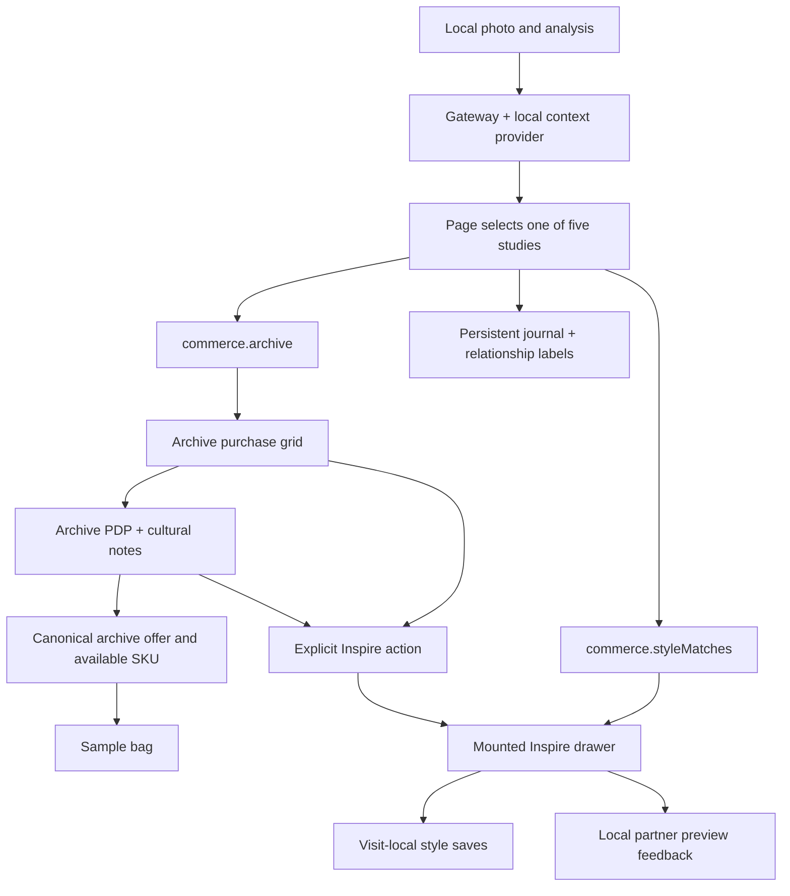

# FirstSight P8–P12 implementation plan and activity ledger

Delivery update, 5 November 2026: the user authorised the combined P5–P12 commit, push and merge to
`new-home-page`. The review-only restrictions below record the earlier implementation period and
are superseded for this checkpoint. See the roadmap for the current delivery boundary.

Recorded: 4 November 2026. Status: implemented; final verification and handoff recorded below.
Branch: `new-analysis`; HEAD: `df562e293f445f0d7cc19e73f5e622ac36b623dd`.
The completed P5–P7 changes are already present and uncommitted. Preserve them.
The user explicitly prohibits committing or pushing this work.

References: [full roadmap](first-sight-roadmap.md), [engineering role](first-sight-engineering-role.md),
[P5–P7 plan and assessment](first-sight-p5-p7-plan.md). Use British English in new prose and copy.

## A. Requirement, problem and expected outcome

The data already separates archive offers and modern style matches, but FirstSight still displays
both in its default grid and automatically promotes alternatives in the PDP. The verified Inspire
drawer has no production entry point. Cultural references have relationship metadata which the
interface does not yet display.

Deliver one continuous consumer flow: analyse a local photograph, select a study, browse its archive
edit and persistent burgundy Style Journal, open an archive PDP, and explicitly opt into The Inspire
from the marketplace or PDP. Style saves and partner previews must remain separate from archive
wardrobe saves and the sample bag. Display authored relationship labels without implying verified
ownership, endorsement or authentication.

## B. Scope and assumptions

- Implement P8–P12 on top of the existing P5–P7 working tree. Do not create a commit or push.
- Keep the existing five studies, 18 offers, 44 references, local upload behaviour and prototype data.
- Retain the page's 50/50 inspiration, 35/65 recognition and 70/30 PDP layouts, with mobile stacking.
- Keep the journal persistent; there is no inactivity timer.
- Archive saves continue through the existing wardrobe callback. Style saves last for the mounted
  FirstSight visit; they never enter shared wardrobe storage. Drawer SKU choices have the same lifetime.
- A partner preview is local feedback; it does not navigate, reserve stock or change the sample bag.
- The global Vault, Discover, Submit, routes, shared catalogue and real services remain outside this slice.
- P13–P16 remain broader later phases; verification necessary for this integration happens now.

## C. Exact implementation and ownership map

Paths starting with `features/` below are relative to `src/`.

| File | Symbols/classes and planned modification |
| --- | --- |
| `pages/FirstSightPage.tsx` | Add `styleMatchOpen`, `savedStyleMatchIds`, derived `archiveProducts`/`styleMatchProducts`; `openStyleMatches`, `closeStyleMatches`, `toggleStyleMatchSave`, `previewPartnerOffer`, guarded archive save, modal/focus transitions; update `changePhoto`, `analyze`, `selectRecognition`, `openProduct`, `addToCart`; mount the drawer once |
| `features/first-sight/commerce.ts` | Add pure `resolveArchivePurchase(archiveProducts, productId, sku)` to return the canonical archive offer and currently available SKU or `null` |
| `features/first-sight/components/StyleMatchDrawer.tsx` | Add optional host fallback for a disconnected or hidden opener; preserve native lifecycle, callbacks and per-product selections |
| `features/first-sight/components/CartPreview.tsx` | Integration amendment: ignore a delayed native close event if the bag has already reopened; preserve normal dismissal |
| `features/first-sight/components/style-match-drawer.css` | Adjust only if production FirstSight CSS affects the mounted drawer's legibility or layout |
| `features/first-sight/components/PurchaseGrid.tsx` | Rename input to `archiveProducts`; defensively filter archive track; use `listingKindLabel`; add meaningful archive-empty presentation; retain archive save/PDP actions |
| `features/first-sight/components/ProductDetailPanel.tsx` | Remove `alternatives`, `onSelectProduct`, `affordableAlternatives`, `AlternativeNote`; add `styleMatchCount`/`onOpenStyleMatches`; show source-linked cultural notes, relationship labels and opt-in prompt |
| `features/first-sight/components/product-detail.css` | Remove obsolete alternative/pair selectors; add `.fs-pdp-style-list`, `.fs-pdp-inspire-prompt` and its accessible responsive trigger; retain product/stock/gallery styles |
| `features/first-sight/components/OutfitMasonry.tsx` | Use `contextRelationshipLabel` for contextual card/dialog labels; retain regions on inspiration boards; update footnote/explanation wording |
| `features/first-sight/components/outfit-magazine.css` | Style `.fs-look-relationship`, including pointer-event protection and long-label wrapping; preserve the journal surfaces and natural image ratios |
| `pages/first-sight.css` | Share baseline badge geometry with `.fs-look-relationship`; preserve geographic badge styles |
| `pages/first-sight-flow.css` | Add `.fs-archive-toolbar-copy`, `.fs-style-match-trigger`, `.fs-style-match-count`, archive-empty treatment, mobile stacking, 44 px targets and focus; maintain commerce priority |
| `features/first-sight/types.ts` | Remove `RecognizedItem.products` and `PurchaseOption.affordable`; simplify `RecognitionStudy` omission once consumers migrate |
| `features/first-sight/services/prototype.ts` | Remove the flattened `products` projection; retain ordered asynchronous context composition and cancellation |
| `features/first-sight/fixtures.ts` | Remove derived `affordable`; retain all authored commercial data |
| `tests/firstSightCommerce.test.mjs` | Add canonical archive selection/stock guard cases; retain price-independent classification checks |
| `tests/firstSightRecognition.test.mjs` | Read explicit streams; assert retired fields are absent; retain dossier, asset, stock and ordering checks |
| `tests/firstSightContentProvider.test.mjs` | Remove legacy product-array expectations; keep provider cancellation/isolation and canonical-content assertions |
| `docs/plans/first-sight-p8-p12-plan.md` | Plan, quality gate, ledger, actual verification and A–G report |
| `docs/plans/first-sight-roadmap.md`, `first-sight-engineering-role.md` | Current authorisation, completion status and adapter removal |
| `docs/plans/first-sight-p8-p12-commit-message.txt` | Detailed review-only EC v1.14.2-style commit message; never execute `git commit` |

## P8 — Page orchestration and commerce action boundaries

**Problem:** the page reads the legacy flat product array and has no owner for Inspire visibility,
style saves or partner preview actions.

**Solution and workflow:**

1. Derive the current archive/style arrays from `selected.commerce`, filtering by the explicit track.
2. Keep the drawer mounted outside the conditional result/PDP branches and without a study key.
   Opening either trigger uses the current study's style matches; closing/reopening retains SKU choices.
3. Keep style saves in a separate page-local array. Validate save/preview requests against the current
   style-match edit and resolve the chosen SKU against the current stock before preview feedback.
4. Resolve archive PDP/save actions against the current archive edit. Add `resolveArchivePurchase`
   so bag actions use the canonical product/variant rather than trusting an incoming object's stock.
5. Close Inspire on photo replacement/removal, analysis, study changes and archive PDP navigation.
   Close the bag before opening Inspire and close Inspire before opening the bag. Avoid stacked modals.
6. Return ordinary dismissals to the actual trigger. When a transition removes it, let the host focus
   the appropriate persistent recognition/shopping section or new PDP. Keep fallback ownership explicit.
7. Pause journal batch injection while Inspire is open without hiding the existing reference cards.
8. Remove `RecognizedItem.products` and its gateway projection once all consumers/tests use commerce.

**Expected result:** the main shopping flow is archive-only, with a stable opt-in modern-style flow.
The sample bag and durable wardrobe cannot receive a partner offer through FirstSight actions.

## P9 — Archive-specific purchase cards

**Problem:** `PurchaseGrid` accepts mixed data and labels offers using the deprecated `affordable` flag.

**Solution:** accept `archiveProducts`, retain authored order, filter out misplaced style matches, and
display Vintage original / Designer reissue / Archive study through `listingKindLabel`. Preserve prices,
sizes, stock, images, save controls and PDP callbacks. An empty archive stream shows a clear local empty
state; it must not fall back to partner offers or disappear behind the no-analysis state.

**Expected result:** every default card communicates its archive listing type. Archive prices do not
determine inclusion, and empty archive edits remain usable alongside available inspiration.

## P10 — Cultural PDP and explicit Inspire entry

**Problem:** the current sidebar automatically selects cheaper offers and opens them as ordinary PDPs.

**Solution:** remove price-based alternative selection and the `AlternativeNote` component. Render
source-linked styling notes with relationship labels, plus a distinct opt-in prompt when style matches
exist. Pass only a count/action into the PDP, keeping the partner catalogue in the drawer. The prompt
should be visible near the sidebar heading, with 44 px controls and readable wrapping. Preserve the
archive's gallery, size choice, price, bag action and wardrobe state when the drawer is opened/dismissed.
Remove obsolete `.fs-pdp-alternative*` and `.fs-pdp-inspiration-pair` rules. Remove `affordable` from the
type and fixture projection after its readers migrate.

**Expected result:** archive shopping stays focused, cultural context remains visible, and alternatives
are available only through a deliberate consumer action.

## P11 — Honest relationship labels

**Problem:** contextual labels currently identify the source category, leaving the authored relationship
to the selected study undisplayed.

**Solution:** use `contextRelationshipLabel` in contextual journal cards, their detail dialogs and PDP
notes. Preserve geographic labels and filtering on the trends board. Update overlay pointer-event
rules so labels do not obstruct photo actions, and allow long labels to wrap at narrow card widths.
Keep original attribution, sources and credits in the detail view. Make wording compatible with all
three relationship values: a manually established design-family link, runway context or styling idea.

**Expected result:** consumers can distinguish styling references from stronger design associations
without needing to interpret fixture/source metadata.

## P12 — Marketplace toolbar and responsive integration

**Problem:** the current toolbar has only a sample-data note and no entry point for The Inspire.

**Solution:** add a clear archive title/count and an opt-in `Explore similar styles` trigger with the
available style count. Use a restrained burgundy outline treatment so archive purchase buttons remain
primary. Hide the trigger when the style stream is empty. Stack toolbar content on mobile and preserve
the burgundy journal panel, natural image proportions and current section geometry. Scope selectors
strongly enough to override `.fs-shop-toolbar button` and check the drawer under `.first-sight` styles.

**Expected result:** the commerce hierarchy is visible, the drawer is discoverable, and narrow screens
retain readable controls without horizontal scrolling or overlapping text.

## D. Trade-offs and strengthened quality gate

The initial roadmap has clear feature ownership but needs explicit integration acceptance. The
following additions address risks found by source inspection and independent planning review.

| Criterion | Strengthening and assessment |
| --- | --- |
| Scope/roadmap alignment | Five connected phases ship together, permitting safe removal of both legacy fields; no route/catalogue migration is needed |
| Business boundary | Canonical offer/SKU resolution, guarded archive saves and independently owned style saves protect the intended split beyond labels |
| State lifetime | One unkeyed, continuously mounted drawer preserves per-product selections across both triggers and study switches |
| Modal transitions | Explicit bag/Inspire exclusion and host focus fallback cover cases the isolated P7 host could not prove |
| Resilience | Test archive-empty, style-empty, no-context, failed provider, changed stock and rapid navigation; no implicit alternative fallback |
| Real styling | Verify the mounted drawer with FirstSight/global styles, inherited disabled opacity, toolbar specificity and long relationship labels |
| Evidence | Snapshot the uncommitted P5–P7 baseline; retain source tests and exercise actual production entry points with browser evidence |

Assessment: ready for implementation after documenting these additions. The plan meets the earlier
slice's ownership and traceability standard and extends it to complete consumer integration. The
additional pure archive-purchase resolver and optional drawer focus fallback are bounded refinements
necessary for the requested boundary and accessibility behaviour.

Local state and existing contracts remain sufficient. No state library, backend, SDK or persistent
style storage is added. The current all-or-nothing provider error policy remains. Automated browser
checks complement visual inspection; they do not establish physical-device or screen-reader coverage.

## E. End-to-end process and activity ledger

1. Read the roadmap, prior assessment, current consumers and EC convention. Record the baseline.
2. Assess/strengthen this plan, then implement the page contract, components and labels together.
3. Migrate consumers/tests and remove obsolete compatibility members only after the new path exists.
4. Verify each integration: grid → drawer, PDP → drawer → retained PDP, archive → bag/wardrobe,
   study switch → matching catalogue/journal, and cancellation/error → retry.
5. Inspect responsive views and failure/empty states; correct demonstrated issues within this slice.
6. Run the final source gates, preservation audit and scope review; record actual results.
7. Deliver the A–G assessment plus an EC-format message as text. Leave Git history untouched.



| Activity | Status | Evidence |
| --- | --- | --- |
| Baseline and ownership inspection | Complete | Typecheck + 31 tests pass; P5–P7 snapshot saved under `/tmp/loomstory-first-sight-qa/p8-p12/` |
| EC v1.14.2 format check | Complete | Official requested page read; type/scope/imperative subject, motivation/body, lines ≤100 characters |
| Plan self-assessment | Complete | Strengthened quality gate above; independent source/planning review |
| P8 orchestration and guards | Complete | Five-study integration, canonical archive actions, isolated style saves, both entry points, hidden/disconnected-opener focus; `products` removed |
| P9 archive grid | Complete | Correct per-study counts, defensive archive filtering, listing labels and archive-empty state verified |
| P10 PDP separation | Complete | Cultural notes and opt-in prompt; gallery/SKU retention verified; alternative renderer and `affordable` removed |
| P11 relationship labels | Complete | Contextual cards/dialog/PDP relationships and unchanged trends geography verified |
| P12 layout/integration | Complete | Five-width layout, scoped accessibility scans, responsive controls and disabled-button contrast verified |
| Integration correction: section contrast | Complete | Darkened the shopping chapter's secondary label after an axe contrast finding |
| Integration correction: hidden opener | Complete | Bag → Inspire → dismiss now focuses the persistent shopping section when the bag's close control is hidden |
| Integration correction: delayed bag close | Complete | A simulated stale close no longer dismisses the reopened bag; real Escape and close-button dismissal still work |
| Source/browser verification | Complete | Typecheck, 35 tests, build, diff check, baseline preservation, fifteen primary and four supplemental browser check groups passed |
| A–G report and commit-format text | Complete | Assessment below and linked message text; no staging, commit or push |

## F. Acceptance and verification workflow

- **All five studies:** archive cards 3/3/3/3/2; style counts 1/1/1/1/2. Default cards/PDP contain no
  partner offers; toolbar and PDP trigger open the correct current edit.
- **Archive integrity:** low-priced archive still appears; style offer cannot resolve for an archive
  purchase; missing/out-of-stock SKU rejected; bag quantities bounded by canonical stock. Archive
  wardrobe saves continue to persist through navigation/reload.
- **Inspire isolation:** preview requires an available size; save/preview never changes archive bag or
  durable wardrobe. Size choices/style saves persist through reopen, both triggers and study switches;
  they reset on a fresh mounted page visit. No fetch, POST or external navigation occurs.
- **Transitions:** photo change/removal, reanalysis, study selection, PDP opening and bag opening close
  Inspire. Ordinary dismissal returns to its trigger; a removed trigger uses the host fallback. No
  overlapping native modals, leaked scroll locks or stale context feedback.
- **Content:** contextual cards/dialog/PDP use relationships; trends retain regions. Source attribution,
  licence data, photo ratios and all canonical dossier/commerce content remain intact.
- **Empty/failure:** zero archive/style/context cases remain coherent; no automatic drawer opening or
  substitute partner grid. Existing analysis error/retry and cancellation remain usable.
- **Responsive/accessibility:** Chrome at 1440, 1024, 768, 390 and 320 px; keyboard, focus return, touch,
  reduced motion, long copy/enlarged text, contrast scan, 44 px new controls and no horizontal overflow.
- **Migration:** no `RecognizedItem.products`, `PurchaseOption.affordable`, legacy projection or
  alternative-renderer consumer remains. Existing arbitrary `products` drawer prop is valid.
- **Gates:** typecheck, meaningful Node tests, build, diff check, baseline comparison and changed-file
  review. Capture screenshots and test harnesses outside Git; keep user photographs ignored.

## G. Delivery boundary

Report only verified results and remaining limitations. Update the roadmap through P12, retaining
P13–P17 for later approval. The EC-style message is a proposed report, with a lowercase imperative
subject, detailed motivation/implementation/verification body, and no invented issue or breaking-change
footer. Source reference: [EC v1.14.2 Git conventions](https://ec.europa.eu/component-library/v1.14.2/ec/docs/conventions/git/).

Do not stage, commit, push, merge or start the next slice. The user will review the complete local work.

---

## Implementation and FDE assessment — 4 November 2026

### A. Requirement and delivered outcome

P8–P12 are complete within FirstSight. The default shopping edit now contains archive offers only.
Modern style matches appear only after choosing **Explore similar styles**, from the marketplace or
archive PDP. The burgundy Style Journal remains visible beside the archive edit and communicates
the authored relationship of each contextual reference.

The end-to-end journey is local photograph or sample → five studies → selected dossier → archive
edit and journal → archive PDP or opt-in Inspire. Archive shopping retains its own bag and wardrobe.
Style saves and partner previews stay separate. This implements the requested commerce hierarchy
without expanding into the global Vault, route migration or live services.

### B. Assumptions and boundaries honoured

- Build on the completed, uncommitted P5–P7 slice; preserve its provider, fixtures and drawer design.
- Keep all five studies, eighteen unique offers, forty-four references, authored order and source
  metadata. A runtime comparison against the starting working tree passed after excluding only the
  deliberately removed compatibility flag.
- Use explicit `commerce.track`; neither price nor a product's name determines its presentation.
- Keep archive wardrobe persistence in the existing app owner. FirstSight guards its own callbacks;
  the shared catalogue/wardrobe and other pages have not been migrated in this slice.
- Keep recognition, inventory, valuations and partner offers illustrative. Local upload remains a
  browser object URL; no live recognition, payment, reservation or external partner navigation occurs.
- Keep style saves and per-product size choices for the mounted FirstSight visit. They reset when
  leaving and mounting the page again, unlike existing archive wardrobe saves.
- Preserve `SubmitPage.tsx`, `DiscoverPage.tsx`, the continuous layout and the journal without a timer.

### C. Technical approach and ownership

The exact file map above is the change index. These are the principal control points for future edits:

| Concern | Implemented owner and behaviour |
| --- | --- |
| Which offers appear | `FirstSightPage` derives filtered `archiveProducts` and `styleMatchProducts` from the selected study; `PurchaseGrid` also rejects non-archive inputs |
| Archive action integrity | `openProduct`, `toggleArchiveSave` and `addToCart` resolve the current edit; pure `resolveArchivePurchase` returns canonical product/SKU objects and requires positive integer stock |
| Inspire visibility | `styleMatchOpen`, `openStyleMatches` and `closeStyleMatches` coordinate both entry points with photo/study/PDP/bag transitions |
| Style save lifetime | `savedStyleMatchIds` and `toggleStyleMatchSave` live in the page; they never call the shared wardrobe callback |
| Partner preview | `previewPartnerOffer` validates the current style/SKU and emits local feedback; it cannot add to the archive bag |
| Size retention and native modality | One unkeyed `StyleMatchDrawer` remains mounted; it owns SKU choices, native dialog state, scroll locking and status feedback |
| Focus return | Drawer cleanup tries its original opener, then `onRestoreFocus`; `restoreStyleMatchFocus` selects a persistent recognition/shopping section or PDP when the opener is removed or hidden |
| Delayed bag events | `CartPreview` ignores a queued native close when the dialog is already open again; normal Escape and close controls still dismiss |
| PDP hierarchy | `ProductDetailPanel` receives only a style count/action; `.fs-pdp-style-list` holds cultural notes and `.fs-pdp-inspire-prompt` opens the separate drawer |
| Cultural meaning | `contextRelationshipLabel` supplies journal card, detail-dialog and PDP labels; trends retain geographic labels |
| Presentation | `.fs-archive-toolbar-copy`, `.fs-style-match-trigger`, `.fs-style-match-count` and `.fs-archive-empty` define the marketplace; CSS remains locally scoped |
| Final contracts | `RecognizedItem.products`, `PurchaseOption.affordable`, the gateway's flattened projection and the old PDP alternatives renderer are removed |

The data path is intentionally small: the existing gateway composes study/context data; the selected
study supplies two explicit commerce streams; each surface reads its own stream. Event handlers
resolve current canonical identities before changing state. This gives future API adapters a clear
boundary without adding a state library, service SDK or backend for the prototype.

### D. Trade-offs and self-assessment

The strengthened plan met its gate and the implementation has no known blocking regression in the
verified scope. It improves on the prior slice's integration evidence in three concrete ways:

1. P7 proved the drawer in isolation. This slice verifies it under actual FirstSight CSS, through both
   real entry points, alongside the bag, PDP, upload lifecycle and persistent journal.
2. The split is enforced by current catalogue membership and canonical SKU/stock resolution, with
   meaningful negative tests. It is not dependent on consumers interpreting labels correctly.
3. The final report distinguishes passing scoped accessibility checks from existing whole-page
   findings, and records integration defects discovered and fixed rather than claiming perfection.

Keeping React local state and native `<dialog>` fits the current size and avoids another dependency.
Keeping the drawer mounted deliberately retains visit-local selections. Defensive rendering adds a
small amount of repeated filtering but protects the consumer boundary if a future adapter misplaces
an offer. Independent source review and the preservation comparison found no concrete blocker.

The prototype does not yet implement the global authenticated Vault, live inventory, content APIs or
production checkout. Browser scenarios are stored as local QA artefacts rather than committed test
infrastructure; P13 should promote the durable regressions into the repository. The broader code and
architecture guides remain P14 work, so this plan and its file map are the current slice reference.

### E. Implementation and integration corrections

| Phase | Actual result |
| --- | --- |
| P8 | Mounted Inspire once; separated page state and actions; guarded canonical archive purchases; coordinated modal transitions and focus; retired flattened products |
| P9 | Archive-only grid, explicit listing labels and a meaningful empty archive state |
| P10 | Removed automatic cheap-alternative rendering and price sorting; retained archive PDP controls; added opt-in Inspire and cultural relationship notes; retired `affordable` |
| P11 | Added contextual relationship labels to cards/dialogs/PDP while retaining source credits, licences and geographic trends |
| P12 | Added archive count and restrained burgundy Inspire trigger, mobile stacking and empty-state styles; verified the existing section proportions |

Four concrete integration corrections were made during verification:

- FirstSight's generic disabled-button opacity weakened the drawer's explicit disabled colours.
  The scoped drawer rule now preserves its intended opacity.
- The shopping chapter's secondary label failed contrast on its section background. Its scoped
  colour is now darker; earlier sections retain their current styles and are reported below.
- A closed bag's trigger remained connected but could not receive focus. Drawer cleanup now checks
  whether focus actually reached the opener before using the host fallback.
- A simulated delayed bag close could dismiss a newly reopened bag after a modal hand-off.
  `CartPreview` now reconciles the event against its current native open state.

The final correction adds one narrowly scoped file to the original map. It is necessary for the
approved P8 modal integration and is not a broader CartPreview refactor.

### F. Verification and remaining gaps

| Check | Evidence/result |
| --- | --- |
| TypeScript | `npm run typecheck` passed |
| Automated contracts | `npm test`: 35 passed, 0 failed; four new archive-action tests plus migrated provider/recognition assertions |
| Production output | `npm run build` passed; no dependencies added |
| Patch hygiene | `git diff --check` passed; no files staged; local photographs remain outside tracked files |
| Fixture preservation | Runtime comparison with the P5–P7 working-tree snapshot passed for studies, commerce and all forty-four references |
| Five-study flow | Archive counts 3/3/3/3/2 and Inspire counts 1/1/1/1/2; explicit labels and correct selected-edit content |
| Action separation | Style saves/previews do not change archive bag or wardrobe; archive persistence and stock-one/stock-two limits still work |
| PDP state | Both entry points work; gallery/SKU state survives drawer use; focus returns to the actual trigger on ordinary dismissal |
| Transitions | Study/PDP/bag/reanalysis/photo-removal transitions close Inspire without stacked modals or scroll-lock leaks; hidden-opener and delayed-close regressions pass |
| Real photo input | Local JPG selection creates a blob preview, closes Inspire, clears stale results and completes a fresh five-study analysis with no upload request |
| Resilience | Archive-empty, style-empty, both-empty, no-context, mixed-track and injected same-design states pass; changed stock/removal disables stale preview; provider error retains photo and retry recovers |
| Responsive/browser | Actual Chrome at 1440, 1024, 768, 390 and 320 px; no horizontal overflow in checked marketplace/PDP/drawer views; both entry points, keyboard return, 44 px new controls and reduced motion checked |
| Touch and text | Emulated touch scroll at 390 px stays inside the drawer, including its boundary; long copy with doubled text fits in the harness |
| Scoped axe | Zero violations in the checked shopping section and drawer at all five widths |
| Whole-page axe | One serious colour-contrast rule with 45 affected nodes in the checked 1440 px workwear page, in earlier inspiration/recognition/dossier content |
| Browser diagnostics | No console/page/HTTP errors or application fetch/POST requests in exercised routes and harness cases |

The primary browser script passed fifteen check groups; supplemental checks passed four groups.
Stress transitions that are normally prevented by native modality invoke existing handlers in the
test harness. The delayed-close case deliberately simulates queued native-event delivery. These
results establish transition resilience, not a claim that consumers click through an inert backdrop.

Chrome may move Tab focus to its own browser controls at a native dialog boundary. The checks permit
that only when `document.hasFocus()` is false and the dialog remains modal; background application
controls must not receive focus. The next Tab returns to the dialog. No custom focus trap was added.

Reproduction commands, from the repository root:

```sh
npm run typecheck
npm test
npm run build
git diff --check
node /tmp/loomstory-first-sight-qa/p8-p12/browser-check.mjs
node /tmp/loomstory-first-sight-qa/p8-p12/supplemental-check.mjs
```

The browser scripts use the existing app at `http://127.0.0.1:5174/first-sight` and a temporary harness
at `http://127.0.0.1:5178/`. Start the latter with
`node node_modules/vite/bin/vite.js --config /tmp/loomstory-first-sight-qa/p8-p12/vite.config.mjs`.
Playwright and axe are installed in the external QA directory, not the application dependencies.

Local evidence directory: `/tmp/loomstory-first-sight-qa/p8-p12/`.

- `browser-results.json`, `supplemental-results.json`: assertions and scoped accessibility results.
- `whole-page-accessibility-findings.json`: remaining contrast selectors and measured ratios.
- `marketplace-{width}.png`, `pdp-{width}.png`, `drawer-{width}.png`: five-width visual evidence.
- `baseline-data.json`, `starting-working-tree.patch`, `starting-status.txt`: starting-slice evidence.

These `/tmp` artefacts are disposable and are not a durable CI suite. Verification was in Chrome;
Safari, Firefox, physical-device touch and a screen-reader session were not performed. Axe does not
establish complete accessibility compliance. The 45 existing contrast findings remain a concrete
follow-up, not a passing whole-page result.

### G. Handoff and recommended next action

Review the local FirstSight journey and the [EC-format report](first-sight-p8-p12-commit-message.txt).
The branch remains `new-analysis` at `df562e293f445f0d7cc19e73f5e622ac36b623dd`; nothing has been staged,
committed, pushed or merged. The working tree contains both the earlier P5–P7 slice and this P8–P12 slice.

Recommend a separately authorised P13–P16 completion slice:

1. Preserve the key integration regressions as repository-owned tests, particularly state isolation,
   stale stock, focus fallback and delayed native events.
2. Update the code guide, architecture, source guide and verification checklist to the final contracts.
3. Correct the recorded contrast findings, then check keyboard/screen-reader use and Safari/Firefox.
   Review narrow-screen card readability with consumers while retaining the editorial visual language.
4. Run the final whole-feature gates and prepare P17 for the user's explicit commit decision.

Do not begin that slice or create a commit based on this recommendation.
